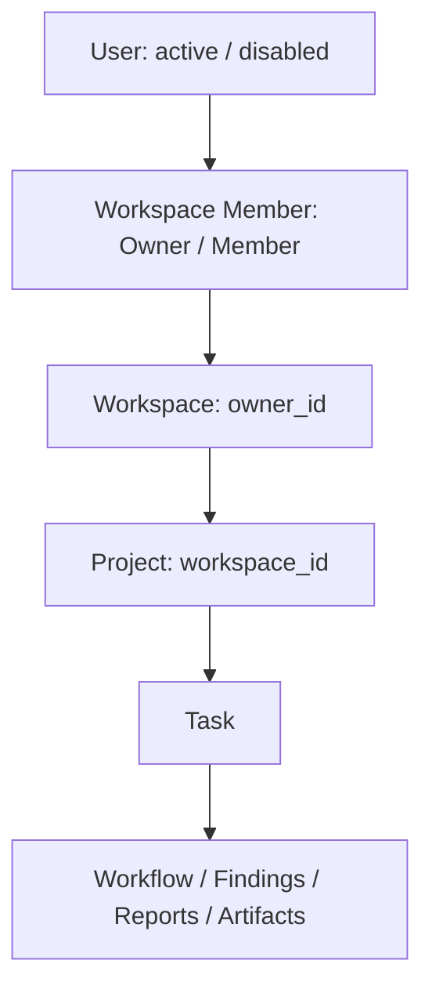
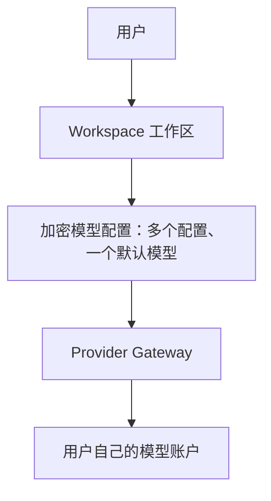

# AutoQA Studio

Phase 6-2-B：工作区 BYOK 模型配置中心，支持多个加密配置、单默认模型与最小连接测试。中文首次使用引导直接进入配置中心，保存后继续下一步。本阶段未扩展首次测试、OpenAPI 或 Web 测试流程。验收见 [模型配置中心报告](docs/phase6-2b.md)；已有引导见 [Phase 6-2-A 报告](docs/phase6-2a.md)。

面向真实 Web / API 项目的 AI 软件测试工作区：解析需求、生成计划、人工审核、受控执行、保留证据与报告。

[](https://github.com/jayoffans/AutoQA-Agent/actions/workflows/ci.yml)

**AutoQA 不提供模型额度。真实模型请求由用户自行配置 Provider API Key，费用计入用户自己的 Provider 账号。**

[Production 部署](docs/production-deployment.md) · [Phase 6-1 认证与隔离验收](docs/phase6-1.md) · [Phase 5 验收与限制](docs/phase5.md) · [旧版使用文档](docs/usage.md)

## Live Demo

[公开体验 AutoQA Studio](https://autoqa-studio-production.up.railway.app/)

Demo 使用 `AUTOQA_MODE=demo`，MockProvider 生成测试计划，执行内置 Login API 真实 HTTP fixture。示例故意接受错误密码，得到 6 个用例、5 个通过、1 个失败。示例 Finding 与报告仅用于 Demo，不代表正式用户的测试结果。

现有线上 Demo 本轮没有部署、清空或修改。Git 历史和测试 fixture 保留。

## Production Use

正式部署必须明确设置 `AUTOQA_MODE=production`，并连接**新的独立数据库**。第一次打开为登录 / 注册入口；注册自动创建个人工作区，项目、任务、问题和执行数全部为 0。

用户流程：

1. 创建 Web 或 API 项目，设置测试环境及 Base URL。
2. 在“设置 / 模型服务”添加 DeepSeek、OpenAI 或 OpenAI 兼容服务，填写模型名称、服务地址和自己的 API 密钥。保存后可测试连接、设为默认或删除。
3. API 项目导入 OpenAPI URL / JSON / YAML，或手动配置接口并选择操作；Web 项目输入目标 URL 和自然语言目标。
4. 检查 AI 计划的测试目标、范围、前置条件、输入和预期结果；修改、增删用例或重新生成。
5. 人工批准后执行，查看每个用例的预期 / 实际、状态、耗时、证据、问题与历史报告。

默认生产操作界面为简体中文，支持 English 切换；文案集中在 `autoqa/static/locales/zh-CN.json` 与 `en-US.json`。服务端错误和导出 HTML 报告目前主要使用中文。旧公开 Demo 界面保持兼容。

用户、Workspace 与 Owner / Member 关系持久化；每个项目属于一个工作区，任务及 Workflow / Finding / Report / Artifact 通过项目继承访问范围。修改 URL / ID 或 `X-Workspace-ID` 不能跨工作区访问数据。Owner 管理模型配置和成员，Member 可以协作测试。

没有模型配置时显示“尚未配置模型服务”。Production 不读取全局开发者模型 Key，不回退 Mock。模型认证 / 额度 / 网络错误作为执行错误保留，不伪装成业务断言失败。

## Authentication Architecture



注册接受 `email`、`password`、`nickname`，同一事务创建 User、个人 Workspace、Owner 成员关系和登录会话。邮箱统一小写且唯一；密码采用带随机盐的 scrypt（N=16384、r=8、p=5），符合 [OWASP 的 16 MiB scrypt 配置](https://cheatsheetseries.owasp.org/cheatsheets/Password_Storage_Cheat_Sheet.html)。保留 Phase 5 密码验证，旧哈希在成功登录时升级。用户响应显式列出基本信息，不包含 password_hash。

| API | 行为 |
| --- | --- |
| `POST /api/auth/register` | 注册并自动登录，返回 user、access_token、refresh_token、csrf_token |
| `POST /api/auth/login` | 邮箱 / 密码认证，返回同样的令牌及用户信息 |
| `POST /api/auth/refresh` | JSON refresh_token 或浏览器 refresh cookie，轮换为新的令牌对 |
| `POST /api/auth/logout` | 撤销当前会话，已签发 access 和 refresh 均失效，清除 cookie 和会话模型配置 |
| `GET /api/auth/me` | 当前用户及所属 Workspace；需要有效 access token |
| `GET /api/auth/csrf` | 验证 refresh cookie 后返回 CSRF，供页面重新打开时恢复登录 |

JWT 使用 PyJWT，固定 HS256，验证签名、issuer、audience、exp、iat、nbf 与 token type；必需 claims 采用 [PyJWT 的 require 配置](https://pyjwt.readthedocs.io/en/stable/api.html)。access 有效期 15 分钟；refresh 最长 7 天，刷新不会延长当前会话的绝对过期时间。每次刷新使用数据库 compare-and-swap 更新 refresh_token_hash，同一令牌并发刷新仅一个成功。数据库保存 SHA-256 refresh 哈希和会话标识哈希，不保存原始令牌。每次生产请求还验证会话、用户 active 状态和成员关系，因此退出、禁用或移除成员后访问立即失效。

JWT 签名密钥通过 HMAC-SHA256 从现有 AUTOQA_SECRET_KEY 按独立用途派生；不增加部署必需变量，AES-GCM 信封格式保持兼容。不要将 Token 放在 URL 或日志中。API 客户端使用 `Authorization: Bearer <access_token>`；浏览器使用 HttpOnly、SameSite=Strict cookie，在 Production HTTPS 上设 Secure，写操作校验 Origin / CSRF。refresh cookie 仅发送到 `/api/auth`。浏览器不将令牌写入 localStorage，access 过期时自动刷新。

Production `/api` 业务入口统一生成 CurrentUser；`X-Workspace-ID` 只能选择当前用户已加入的 Workspace，不能用作授权证明。项目按 workspace_id 查询，任务通过 TaskMetadata → Project 检查归属；Workflow、Finding、Report、SSE 与 Artifact 共用任务归属检查。跨工作区返回 404，不披露资源名称或内容。Artifact 没有公开文件目录，文件名经过校验，路径必须位于当前任务目录；拒绝路径遍历及符号链接。退出或切换工作区时前端清除数据并丢弃旧请求结果。

Owner 可配置模型及添加已注册的 Member；本阶段不实现所有权转移、额外角色、邮件、支付、企业 RBAC 或新的 Onboarding 流程。Demo 保持公开体验和 Seed，使用原有独立入口。

## BYOK Architecture



**AutoQA 不提供模型额度。** 所有模型请求（包括测试连接）由用户自己的模型账户计费，Production 不使用开发者环境变量中的 Key，也不回退到 MockProvider。

`AUTOQA_SECRET_KEY` 是随机 32 字节的服务端主密钥。用户输入 API 密钥 → FastAPI → **AES-256-GCM** → 数据库 `encrypted_api_key`；每次加密使用独立的 12 字节 nonce，GCM 自带认证标签。新持久配置的 associated data 同时绑定工作区与配置 ID，防止密文在记录或工作区之间交换。旧配置保持原工作区绑定信封，迁移不解密或重写密文。API 与页面只返回 `sk-********1234`，不返回完整密钥或密文。删除配置清除数据库中的密文；新建配置可更换密钥。

一个工作区可保存多个统一结构的 `ProviderConfig`：`id`、`workspace_id`、`provider`、`model_name`、`base_url`、`encrypted_api_key`、`api_key_hint`、`is_active`、`created_at`、`updated_at`。另有连接状态与内部默认槽位。数据库的唯一默认槽位和 CHECK 约束保证每个工作区最多一个默认模型；写操作按工作区串行化。新增配置自动成为默认，删除默认配置后启用最近添加的备用配置。配置列表、删除、切换和测试都通过当前用户的工作区成员关系及 `workspace_id` 查询；只有 Owner 可以更改配置或发起付费连接测试。

DeepSeek 默认地址为 `https://api.deepseek.com`，推荐填写 `deepseek-chat`；OpenAI 默认地址为 `https://api.openai.com/v1`，模型由用户填写；OpenAI 兼容服务需自定义服务地址与模型名称。地址校验继续使用现有网络策略与连接时 DNS 固定，默认只允许公共 HTTPS，禁用重定向，不将 API 密钥放入 URL。

| API | 行为 |
| --- | --- |
| `GET /api/settings/providers` | 当前工作区配置列表，仅返回掩码及状态 |
| `POST /api/settings/providers` | 接受 provider、model、api_key、base_url；加密保存，新配置设为默认 |
| `DELETE /api/settings/providers/{id}` | 删除当前工作区配置；删除最后一个后恢复未配置状态 |
| `POST /api/settings/providers/{id}/test` | Gateway 创建临时 HTTP 客户端，发送一次最小模型请求 |
| `POST /api/settings/providers/{id}/activate` | 切换工作区默认模型 |

连接测试使用 `/chat/completions`，仅一条消息、`max_tokens=1`，15 秒超时与 64 KiB 响应上限。成功返回 `{"status":"success","model":"deepseek-chat"}`；失败统一返回中文说明，不返回异常堆栈、服务商错误正文或密钥。客户端在请求后关闭，解密密钥仅在请求局部使用。连接状态为待测试 / 成功 / 失败；仅成功探测后工作台显示“✓ 模型已连接”。保存配置更新 `model_configured=true`，在引导第 2 步保存后继续项目创建，不标记第一次测试已完成。

旧 `/api/provider` GET / PUT / DELETE 和 `/api/provider/test` 保持兼容，业务调用继续经 Provider Gateway 选择当前默认模型；现有 Provider 适配器与 Agent 调用逻辑保持不变。

支持两种模型配置保存方式：

- **仅本次使用**：加密配置只存在当前服务进程内存，绑定用户登录会话与工作区，退出 / 过期 / 重启后不可使用。列表标识 `id=session`，可测试或删除。此方式会临时覆盖当前会话的工作区默认模型。
- **保存到工作区**：数据库保存加密配置，工作区成员共享模型服务，费用计入该工作区配置的 Provider 账号。

密钥解密只在 Provider 请求局部使用，完成后清除对象中的引用；这不是对 Python 内存的物理擦除保证。Provider Gateway 使用用户提供的 Base URL / Model / Key，不配置免费真实模型额度。

环境认证 Header、Token、Password、自定义敏感变量及保存的测试账号也通过 AES-GCM 加密。计划只保存 `{{TOKEN}}` / `{{USERNAME}}` / `{{PASSWORD}}` 等占位符。临时账号仅本次任务使用，任务完成后清除内存密文。已知秘密会从输出、日志、DOM 与响应证据中移除。Production 禁用 Playwright Trace；配置运行变量时不保存截图，避免目标页面把密码回显到图像中。

## Testing Architecture

保留 FastAPI、SQLAlchemy、LangGraph 和 Playwright。Production 复用既有浏览器工作流、执行器、Store 和报告系统，为 API 项目加入通用接口执行器。

API 支持 OpenAPI 3.x / Swagger 2.0 的 path、method、parameters、JSON request body、response schema 和本地 `$ref`，不再限定 Login API。远程 / 循环引用需预先打包；当前不是完整的 OpenAPI 兼容性实现，不支持 multipart、OAuth 自动取令牌、递归 schema 和任意复杂 JSON Schema 方言。

Web 测试观察用户真实页面、规划可审核动作、执行断言并保存证据。任务不会默认指向 AutoQA 页面。生产模式所有计划，包括只读断言，都必须人工批准；关键步骤可以继续单独审批。多用例 Web Suite、自动浏览器登录发现与复杂跨域业务流程尚未完善。

业务失败来自实际执行断言。系统 / Agent / 网络异常记为 `system_error`。Finding 显示受影响目标、预期、实际和证据；修复提示标注“AI 分析建议”，`root_cause_confirmed=false`。当前故障归类和提示仍包含规则逻辑，不能视为已证实的后端根因。

公网目标采用 HTTP(S) 检查、DNS 解析、公网 IP 校验和连接 IP 固定，校验重定向并限制响应大小。默认禁止 localhost、私有 IP、link-local、metadata、file URL、任意 shell / 脚本动作与服务器文件访问。自托管允许内网需要显式 opt-in；metadata IP 始终禁止。运行测试须使用已获授权的环境和测试账号。

## Database Migrations

Alembic 替代仅依赖 `create_all` 的建表方式：

- `0001_legacy`：识别并补齐旧结构，不删除旧行。
- `0002_product`：users、workspaces、workspace_members、user_sessions、provider_configs、environment_configs、api_contracts、deployment mode marker，以及项目 ownership / 类型 / 环境字段。
- `0003_auth`：用户 nickname / is_active / updated_at、工作区 owner_id / updated_at、成员 id / created_at、会话 refresh_token_hash / created_at。回填旧成员及 Owner，保留已有密码、工作区名称和项目。历史无成员工作区允许 owner_id=NULL，历史 Demo 项目继续保持未归属；新注册与项目创建必有有效归属。
- `0004_onboarding`：保存新用户首次使用引导进度，老用户不创建引导记录。
- `0005_provider_center`：`provider_configs` 从工作区主键改为配置 ID 主键，保留工作区索引；`model` 改为 `model_name`，`key_mask` 改为 `api_key_hint`，增加默认状态、连接状态与时间字段。逐条原样复制旧密文，旧配置 ID 使用原 workspace_id，保持解密兼容。默认槽位唯一约束在 SQLite / MySQL 均适用。

旧项目保持 `workspace_id=NULL`，不会自动分配给新用户。数据库模式标记阻止 Demo / Production 复用数据库；正式模式拒绝接管旧 Demo 业务库。迁移前备份；没有自动破坏性 downgrade。

Phase 5 的旧 cookie 会话保留记录，但不能用于新 JWT 认证，升级后用户需要重新登录；业务数据不受影响。启动使用 Alembic，不调用 create_all。账号禁用目前通过维护者更新 is_active，没有新增管理后台。

## Self-hosting

```bash
pip install -r requirements.lock
pip install --no-deps -e .
python -m playwright install chromium
# 设置 .env：production 模式、主密钥、独立数据库、HTTPS 域名
python -m alembic upgrade head
python -m autoqa
```

Docker 与 Railway 环境变量、Volume、数据库及 HTTPS 配置见 [正式版部署指南](docs/production-deployment.md)。不要复制开发者模型 Key。当前要求单进程 / 单副本；临时配置和运行队列不能跨进程共享。

## Production Compatibility

支持 **SQLite development** 与 **MySQL production**。数据库使用 **Alembic**，现有迁移链为
`0001_legacy → 0002_product → 0003_auth`。Production 必须显式注入 `DATABASE_URL` 和
`AUTOQA_SECRET_KEY`；没有默认生产数据库地址或开发密码。MySQL 迁移与生产连接统一使用 UTC。

独立生产容器入口为 `compose.production.yaml`。先在本机未跟踪的 `.env.production` 中配置
`AUTOQA_MODE=production`、`AUTOQA_ENV=production`、随机主密钥、显式 MySQL URL，以及
`MYSQL_DATABASE`、`MYSQL_USER`、`MYSQL_PASSWORD`、`MYSQL_ROOT_PASSWORD`，然后执行：

```bash
docker compose --env-file .env.production -f compose.production.yaml build
docker compose --env-file .env.production -f compose.production.yaml up -d --wait
```

容器接受 `AUTOQA_MODE`、`AUTOQA_ENV`、`AUTOQA_SECRET_KEY`、`DATABASE_URL`、
`AUTOQA_DATA_DIR`、`AUTOQA_ARTIFACT_DIR` 环境变量。默认命名卷分别保存 MySQL 数据、
`/app/data` 与 `/app/artifacts`；自定义目录应位于这两个应用卷内。重建时使用 `down`，保留卷；
`down --volumes` 会删除数据。生产浏览器需要 HTTPS；验收使用本机临时 TLS 入口。

CI `auth-mysql` 执行空库迁移、SQLite / MySQL 认证与权限测试、服务重启与 Chromium 验收。
`docker-production` 实际执行 Docker build、Compose up、`GET /health`、环境变量注入、
容器重建后的卷持久化与 HTTPS 浏览器流程。测试使用随机临时凭据和本地 Mock HTTP Provider，
不访问真实模型、不修改生产 Provider 的 BYOK 行为。

**Container: Docker verified** — 已在 GitHub Actions 的真实 Docker / MySQL 环境完成上述容器验收；
证据与具体限制见下方报告。

现有 `compose.yaml` / `docker-compose.yml` 继续作为 Demo 入口，`AUTOQA_MODE=demo` 与 Seed
保持兼容。本阶段没有部署 Railway、修改公开 Demo 或合并 main。

具体实测结果及未覆盖范围见 [Phase 6-1.5 验收报告](docs/phase6-1.5.md)。

## Verification

```bash
ruff check autoqa tests scripts migrations
pytest -q --junitxml=work/test-results.xml
node --check autoqa/static/production.js
node --check autoqa/static/i18n.js
```

保留旧浏览器、Demo、报告、代理限额与数据库测试。新增空 Production、用户 / 工作区 / 对象隔离、BYOK、加密、掩码、无回退、OpenAPI、环境秘密、Alembic 和真实 Chromium 验收。CI 仅使用 fixture Key 和 Mock HTTP，不产生真实模型费用；MySQL 使用独立的 Demo 与 Production 测试数据库。

Phase 6-2-B 专项测试位于 `tests/test_provider_center.py`、`tests/test_provider_center_compat.py` 与 `tests/test_provider_center_browser.py`。安全与 API 用 fake transport，数据库兼容用本地 Mock HTTP Server，浏览器使用假密钥。MySQL CI 运行相同迁移与配置流程，覆盖旧密文升级、多配置、连接、默认切换和删除；不会读取宿主机真实模型 Key。

认证、刷新轮换、并发刷新、跨用户资源隔离及真实 Chromium 双用户流程的本轮结果见 [Phase 6-1 报告](docs/phase6-1.md)。MySQL CI 还验证带 Phase 5 用户、工作区和项目的升级及重新登录。没有真实模型依赖。

完整结果、未实际验收项目和上线前缺项见 [Phase 5 报告](docs/phase5.md) 和 [Phase 6-1 报告](docs/phase6-1.md)。
