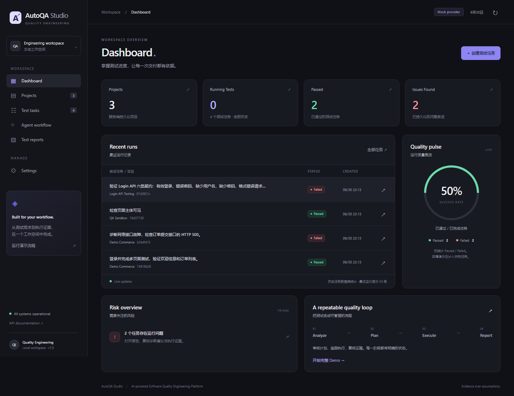
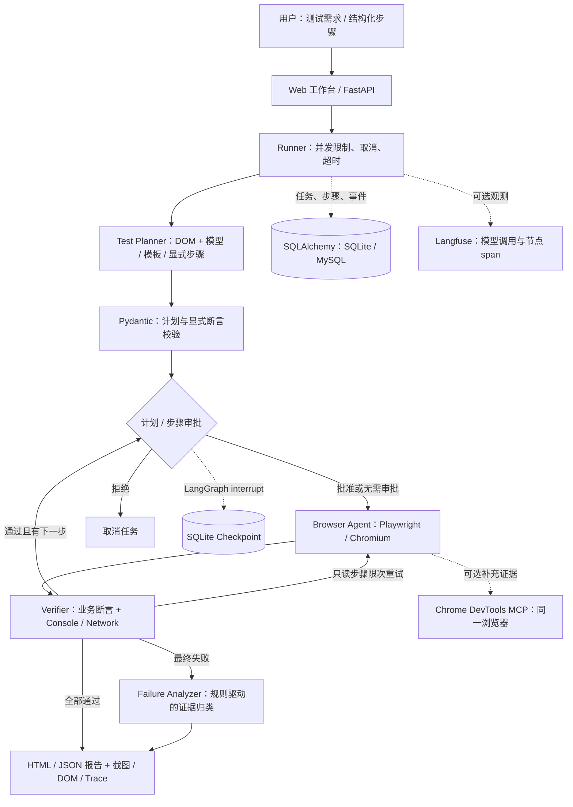
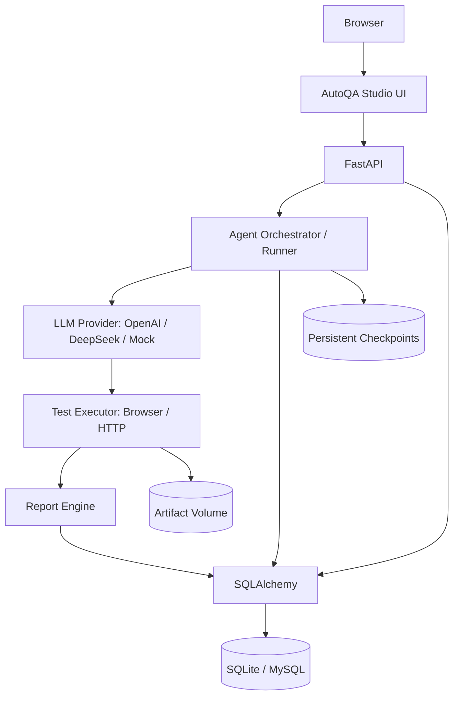

# AutoQA Studio

> AI-powered Software Quality Engineering Platform — 管理测试流程、执行证据与质量报告。

[](https://github.com/jayoffans/AutoQA-Agent/actions/workflows/ci.yml)

**Python 3.11+ · FastAPI · LangGraph · Playwright · SQLite / MySQL**

[Phase 2 后端与部署](docs/phase2.md) · [Studio 产品说明与五步 Demo](docs/studio-guide.md) · [快速启动](#quick-start--运行方式) · [系统架构](#architecture--系统架构) · [Demo 展示](#demo) · [验收记录](docs/validation.md) · [配置与 API](docs/usage.md)

## 项目简介

Web 测试通常需要人工编写操作步骤、检查页面结果，再结合截图、浏览器日志和接口响应定位失败。AutoQA Studio 将这条流程组织为可追踪的工作流：读取目标页面，生成或接收测试计划，通过真实 Chromium 执行操作和断言，保存证据并输出 HTML / JSON 报告。

大模型参与 **Test Planner**，将自然语言需求与当前页面 DOM 转成受 Schema 约束的计划；执行、校验和故障分析由确定性工具节点完成。无需模型密钥也能使用内置演示模板，验证浏览器、工作流、审批和证据链路。



截图中的失败任务来自故意注入故障的演示场景。工作台任务通过率与评测的“预期结果匹配率”是不同指标。

## 应用场景

| 场景 | 使用方式 | 输出与价值 |
| --- | --- | --- |
| Web 回归测试 | 通过 API 提交固定步骤与显式断言 | 重复执行登录、跳转、表单等流程，保存每次结果 |
| 测试计划辅助生成 | 配置模型，在授权测试环境输入需求 | 基于当前页面 DOM 生成结构化计划，执行前校验与审批 |
| 失败排查 | 检查 HTTP 错误、请求失败、Console 与页面状态 | 区分网络、前端、元素、断言等故障，提供可复核证据 |
| Agent 工程展示 | 内置可控站点复现成功、失败、审批与重试 | 展示状态编排、人工介入、持久化和自动化验收 |

Phase 2 已通过真实 DeepSeek / deepseek-flash 的 Login API E2E：生成六类计划、人工审核、真实 HTTP 执行、5 通过 / 1 失败 / 1 条 High Finding，并验证重启后持久化。浏览器开放站点泛化仍未验收；MySQL / Docker 运行尚未验证。详见 [验收记录](docs/phase2.md)。

## Architecture / 系统架构



LangGraph 编排规划、审批、执行、校验和失败分支。任务数据、图检查点和浏览器证据分别保存；持久化检查点不等于持久化浏览器会话。实际状态图、恢复语义与重试范围见 [架构说明](docs/architecture.md)。

## Features / 核心功能

| 功能 | 实际实现 |
| --- | --- |
| 三种规划模式 | `demo` 内置模板；`structured` API 显式步骤；`llm` OpenAI 兼容接口 + DOM 观察 + Pydantic 校验 |
| 真实浏览器执行 | 导航、点击、输入、选择、按键、等待、截图，同一会话内多页面流程 |
| 显式结果校验 | 文本、元素、URL 断言；严格模式检查 HTTP 错误、请求失败、Console 与未授权跳转 |
| 人工审批 | 完整计划与指定步骤使用 LangGraph `interrupt` 暂停，通过 `Command(resume=...)` 继续或拒绝 |
| 证据诊断 | 分类网络、前端、元素、断言与执行故障，输出依据和建议，保留 `root_cause_confirmed=false` |
| 工作台与报告 | 六页产品工作台、SSE 实时事件、每步截图与 DOM、Playwright Trace、HTML / JSON 报告 |
| 执行约束 | 步骤上限、单步 / 任务超时、并发限制、取消、只读步骤限次重试、来源允许列表 |
| 可选集成 | Chrome DevTools MCP 读取同一浏览器的 Network / Console / DOM；Langfuse 记录模型与节点观测 |

`demo` 仅支持内置站点的已定义需求，未知需求会明确报错。模型调用失败或计划无效也会明确失败。所有计划必须包含断言，不能仅凭操作完成判定测试通过。

## Tech Stack / 技术栈

| 层次 | 技术 | 职责 |
| --- | --- | --- |
| 服务与接口 | Python 3.11+、FastAPI、Uvicorn | 任务 API、SSE、审批、证据下载、OpenAPI |
| Agent 编排 | LangGraph、SQLite Checkpointer | 条件分支、状态持久化、人工审批与恢复 |
| 规划与校验 | HTTPX、OpenAI 兼容 API、Pydantic | 模型请求、结构化步骤与计划校验 |
| 浏览器与证据 | Playwright、Chromium | 页面操作、运行事件、截图、DOM、Trace |
| 业务存储 | SQLAlchemy、SQLite、PyMySQL / MySQL | 任务、步骤与事件持久化 |
| 展示层 | 原生 HTML / CSS / JavaScript | 组件化 ES modules 工作台，无需前端构建 |
| 可选观测 | Chrome DevTools MCP、Langfuse SDK | 补充浏览器证据、工作流与模型调用观测 |
| 测试与部署 | pytest、Ruff、GitHub Actions、Docker Compose | 自动化验收、静态检查、Linux CI 配置与部署定义 |

依赖范围见 [pyproject.toml](pyproject.toml)，可复现安装使用 [requirements.lock](requirements.lock)。

## Quick Start / 运行方式

### Windows 一键启动

需要 Python 3.11+。本地演示默认使用 SQLite，无需 Docker、MySQL 或模型密钥。

首次安装与启动：

```powershell
cd "D:\agent 项目\AutoQA-Agent"
.\start.cmd -Setup
```

之后双击 `start.cmd`，或执行 `.\start.cmd`。打开 [测试工作台](http://127.0.0.1:8765/)，点击「开始完整 Demo」，选择「登录与多页面」并「生成测试计划」，审核后执行。未配置模型时显示 `Demo templates`。API 文档位于 [本地 OpenAPI](http://127.0.0.1:8765/docs)。

### Windows 手动启动

```powershell
python -m venv .venv
.\.venv\Scripts\python.exe -m pip install -r requirements.lock
.\.venv\Scripts\python.exe -m pip install --no-deps -e .
.\.venv\Scripts\python.exe -m playwright install chromium
.\.venv\Scripts\python.exe -m uvicorn autoqa.app:app --host 127.0.0.1 --port 8765 --workers 1 --no-access-log
```

### Linux / macOS

```bash
python3 -m venv .venv
source .venv/bin/activate
pip install -r requirements.lock
pip install --no-deps -e .
python -m playwright install --with-deps chromium
uvicorn autoqa.app:app --host 127.0.0.1 --port 8765 --workers 1 --no-access-log
```

当前版本使用 **单个 Uvicorn worker**，活动浏览器与调度器位于进程内。内置演示来源读取 **PORT**（默认 8765）与平台公共域名。

自己的测试站点、模型配置、API 示例、Docker + MySQL、MCP 和 Langfuse 设置见 [配置与部署说明](docs/usage.md)。复制 `.env.example` 为 `.env`，填写配置后重启服务；推荐使用 `LLM_PROVIDER`、`LLM_MODEL` 和对应服务商 API Key；旧 `AUTOQA_LLM_*` 兼容设置继续支持。

## 测试结果

以下结果来自 **2026-09-30 已保存的验收记录**，原始数据可复核：

| 验证项 | 结果与范围 | 证据 |
| --- | --- | --- |
| 自动化测试 | **37 / 37 通过**，保留原有 22 项，新增 15 项持久化与 Provider 测试 | [Phase 2 JUnit](docs/phase2-test-results.xml)、[原验收 JUnit](docs/test-results.xml)、[验收说明](docs/validation.md) |
| 受控演示评测 | **7 / 7 场景符合预期**，覆盖正确通过与故意失败的状态 / 诊断类别 | [评测数据](docs/evaluation-results.json) |
| DevTools MCP | 同一 Chromium 页面采集与真实 HTTP 500 验证通过 | [MCP 摘要](docs/mcp-verification.json) |
| 静态检查 | 本次 Ruff 与三个 JavaScript 模块语法检查通过；扩展浏览器 UI 验证通过，含共享项目与刷新后的流程/报告 | [Phase 2 验收说明](docs/phase2.md#validation) |
| 持续集成 | Linux / Python 3.12，配置 Ruff、pytest、JS 语法、Mock UI 与 Compose 检查（本次未触发远程 CI） | [CI 配置](.github/workflows/ci.yml)；当前状态见顶部徽章 |

**7 / 7 是受控场景预期匹配结果，不是业务流程全部成功或模型准确率。** 真实模型 Login API 验收已完成；Docker 镜像构建 / MySQL 运行、Langfuse 云端看板与真实第三方业务系统尚未完成验收。

复验前先停止占用 8765 的工作台，测试会自行启动隔离数据与浏览器实例。激活虚拟环境后执行：

```bash
ruff check autoqa tests scripts
pytest -q
```

演示评测需要工作台正在运行：

```bash
python scripts/evaluate.py --output work/evaluation-results.json
```

此输出路径保留仓库中的历史评测数据。覆盖范围与本次文档修改检查见 [验收记录](docs/validation.md)。

## 工程亮点

- **模型输出进入可校验的执行协议**：有限动作集合与 Pydantic 校验约束模型输出，拒绝无效字段、超限计划与缺少断言的步骤，执行器不接受任意 JavaScript。
- **人工审批有真实状态语义**：检查点与 `interrupt` 保留暂停位置，批准后继续；浏览器丢失时明确拒绝重放已进行的操作。
- **失败结果可以复核**：每次尝试独立保存截图、DOM、耗时与运行证据，分别捕获 HTTP 错误响应和传输失败，区分故障分类与根因确认。
- **重试受操作类型约束**：仅只读步骤可限次重试，点击、输入、选择和按键失败后不自动重放；步骤数量、超时和并发都有上限。
- **业务数据、图状态与观测分工明确**：SQLAlchemy 保存业务数据，SQLite 保存图检查点，SSE 与本地 Trace 提供基础观测，可选 MCP / Langfuse 补充证据与调用链。
- **可复现演示与自动化验收**：内置成功、故障、审批与延迟场景，通过真实浏览器测试及 Linux CI 配置验证执行语义。

## Demo

建议先录制 **60–90 秒**视频，围绕三个可复现结果讲解：

| 顺序 | 操作 | 展示重点 |
| --- | --- | --- |
| 1 | 「登录与多页面」→「生成测试计划」→ 审核并执行 | 8 个步骤、登录会话、跨页面断言、最终截图与报告 |
| 2 | 「接口故障」→ 打开失败任务详情 | 预期故障 `failed / network_error`，HTTP 500 证据与诊断建议 |
| 3 | 「表单审批」→ 展示暂停 → 批准 | 提交前等待确认，批准后继续并验证结果 |

开场说明当前规划模式。无模型密钥时使用固定模板，浏览器与执行链路真实运行。原有 22 项测试加 Phase 2 的 15 项，合计 37 项自动化测试，是独立测试套件，不是单次 Demo 的步骤数。

新版 Dashboard、Workflow、Report 和移动端截图位于 `docs/screenshots/studio-*.png`，浏览器验证记录见 [Studio UI 验证](docs/studio-ui-results.json)。原工作台截图保留在 `docs/screenshots/workspace.png`。录制分镜见 [Demo 与展示素材说明](docs/demo-guide.md)。本页直接使用 Mermaid 展示架构图，详细状态图见 [架构说明](docs/architecture.md)，无需空白图片占位。

## 项目结构

```text
autoqa/
  app.py              # FastAPI、SSE、报告、审批与静态工作台
  workflow.py         # LangGraph 节点、分支与 interrupt
  runner.py           # 并发限制、取消、超时与生命周期
  planner.py          # 模型 / 模板 / 显式步骤规划
  schemas.py          # 动作协议、计划与断言约束
  browser.py          # 浏览器动作、证据、来源与重定向校验
  diagnosis.py        # 规则驱动的故障证据归类
  store.py            # 项目、任务、运行、Finding、报告与幂等补齐
  studio_models.py    # 复用旧任务的新增关联模型
  providers.py        # OpenAI / DeepSeek / Mock Provider
  api_workflow.py     # Login API 计划、人工审核与真实 HTTP 执行
  __main__.py         # PORT + 0.0.0.0 生产启动
  mcp_bridge.py       # 同一浏览器的 DevTools MCP 客户端
  telemetry.py        # Langfuse SDK observation
  static/             # Studio 工作台、组件与展示模型
  demo/               # 可控浏览器测试站点
tests/                 # 浏览器 E2E、接口边界与观测测试
scripts/               # Windows 启动、评测与 MCP 验证
docs/                  # 架构、配置、验收、演示、截图与原始数据
.github/workflows/     # Linux 自动化测试
start.cmd              # Windows 一键启动
requirements.lock      # 锁定安装依赖
compose.yaml           # 应用 + MySQL + 持久化卷
```

## 当前边界

当前采用单进程任务调度、一次性模型规划、规则驱动诊断；支持浏览器和 Login API 两种执行流程。跨浏览器、验证码、复杂 iframe、站点账号管理和分布式队列不在验收范围。浏览器状态不会在重启后自动重放；计划审批与执行中会话丢失的处理不同，见 [恢复语义](docs/architecture.md)。

测试目标需要明确授权并加入来源允许列表。API 与事件会脱敏输入值，但原始 Trace、页面正文和站点 Console 仍可能包含测试数据；导出展示素材前检查内容。详细来源约束、访问令牌与部署要求保留在 [配置说明](docs/usage.md)。

## Phase 2 Architecture



## Environment Variables

复制 `.env.example` 为 `.env`；本地文件和密钥禁止提交 Git。

| 变量 | 用途 |
| --- | --- |
| DATABASE_URL | SQLite / MySQL SQLAlchemy URL；兼容 AUTOQA_DATABASE_URL |
| LLM_PROVIDER | compatible / openai / deepseek / mock |
| LLM_MODEL | 实际模型 ID；DeepSeek 可用 auto 解析可用 ID |
| OPENAI_API_KEY / DEEPSEEK_API_KEY | 服务端凭据 |
| AUTOQA_ENV | development / production / test |
| AUTOQA_API_TOKEN | 共享 API 令牌；production 必须设置 |
| PORT | 默认 8765，生产入口读取 |
| AUTOQA_DATA_DIR / ARTIFACT_DIR | Checkpoint / 证据相对路径或挂载路径 |
| AUTOQA_ALLOWED_ORIGINS / RESOURCE_ORIGINS | 授权测试目标与资源来源 |
| AUTOQA_PUBLIC_BASE_URL | 本平台公开来源；Railway 可读取 RAILWAY_PUBLIC_DOMAIN |
| AUTOQA_DEMO_LOGIN_FAULT | 控制 Login API 演示缺陷，默认 true |

## Database

默认 SQLite 自动初始化。复用 tasks / steps / events，新增 projects、task_metadata、test_plans、test_cases、test_runs、findings、reports、workflow_steps、schema_versions。启动时幂等补齐旧任务，不改写旧表。MySQL 使用相同模型；生产账号密码仅来自环境。完整字段和迁移边界见 [数据库说明](docs/phase2.md#database)。

## Docker

在 .env 中设置 MYSQL_PASSWORD 和 MYSQL_ROOT_PASSWORD，然后：

```bash
docker compose config --quiet
docker compose up --build -d
```

服务包含 autoqa 与 mysql。数据库、Checkpoint 与证据使用持久化卷，容器使用普通用户；没有硬编码数据库密码。当前主机没有 Docker CLI/引擎，未实际运行容器或 MySQL，结构检查结果见 [Phase 2 验收](docs/phase2.md#validation)。

## Testing

```bash
pytest -q
ruff check autoqa tests scripts
node --check autoqa/static/app.js
python scripts/verify_studio.py
python scripts/validate_deployment.py
```

pytest 前停止占用 8765 的服务。CI 使用临时 SQLite 与 Mock，不要求真实凭据。UI 脚本在空的隔离实例运行；它会创建真实测试任务。已有 .env 含真实模型时，测试运行前用环境变量 LLM_PROVIDER=compatible、LLM_MODEL=空、OPENAI_API_KEY=空、DEEPSEEK_API_KEY=空隔离真实调用；原测试已自行关闭旧兼容接口凭据。

## Demo: Login API Testing

选择内置 Login API Testing 场景，Provider 生成 Valid login、Invalid password、Missing username、Missing password、Malformed payload、Unauthorized request 六类 Case，先人工审核再发送真实请求。默认服务注入错误密码校验缺陷，报告显示 5 Passed / 1 Failed / Coverage 100% / 1 High Finding；关闭缺陷开关后由实际请求重新计算结果。

真实模型验收记录：[DeepSeek E2E](docs/phase2-llm-results.json)。报告和 Workflow 刷新与服务重启后仍可查询。

## Deployment: Railway

仓库提供 Dockerfile 与 railway.toml。创建应用服务和 MySQL 服务，配置生产 API Token、MySQL DATABASE_URL、模型 Provider / Key / Model；将 /app/data 挂载为持久化卷，并把 Checkpoint / Artifact 指向其中。应用通过 `python -m autoqa` 监听 0.0.0.0:$PORT，healthcheck 为 /api/health。只运行一个实例。完整变量、MySQL 服务引用与限制见 [部署步骤](docs/phase2.md#deployment)。

本次没有操作 Railway 账号或发布公网服务。当前支持多人共享工作空间，没有独立用户/租户、RBAC 或分布式执行。
