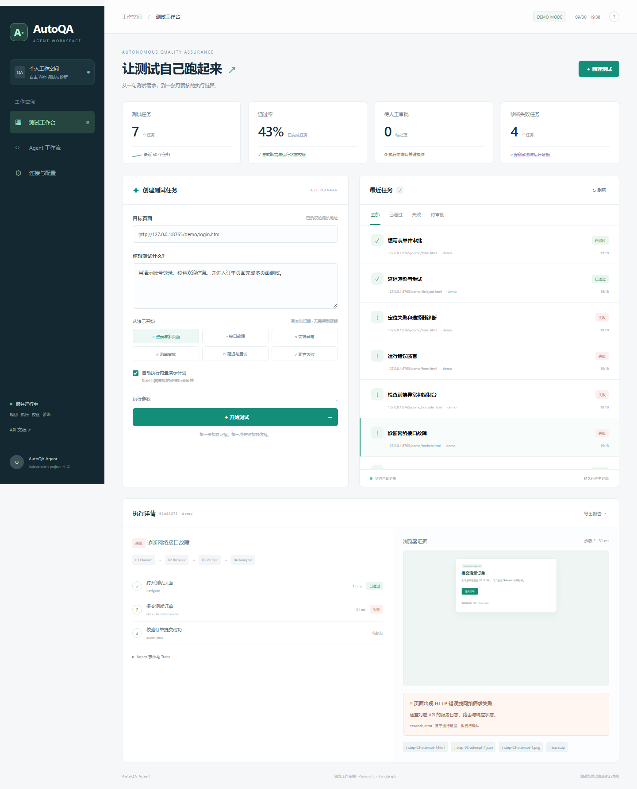

# AutoQA Agent

**自主 Web 测试与故障诊断智能体。** 输入测试需求，生成可执行计划，在真实 Chromium 中运行，并输出步骤截图、DOM、Console、Network、Playwright Trace 和诊断报告。

这是独立的 Python 项目，拥有自己的 Git 仓库、虚拟环境、数据库、浏览器上下文和运行目录。



## 5 分钟启动

需要 Python 3.11+。Windows 本地运行不需要 Docker、MySQL 或模型密钥。

```powershell
cd "D:\agent 项目\AutoQA-Agent"
python -m venv .venv
.\.venv\Scripts\python.exe -m pip install -r requirements.lock
.\.venv\Scripts\python.exe -m pip install --no-deps -e .
.\.venv\Scripts\python.exe -m playwright install chromium
.\.venv\Scripts\python.exe -m uvicorn autoqa.app:app --host 127.0.0.1 --port 8765 --workers 1
```

打开 <http://127.0.0.1:8765>，选择「登录与多页面」并开始测试。也可以双击 `start.cmd`，首次安装使用 `start.cmd -Setup`。

Linux / macOS：

```bash
python3 -m venv .venv
source .venv/bin/activate
pip install -r requirements.lock
pip install --no-deps -e .
python -m playwright install --with-deps chromium
uvicorn autoqa.app:app --host 127.0.0.1 --port 8765 --workers 1
```

## 实现内容

| 模块 | 实际行为 |
| --- | --- |
| Test Planner | DOM 观察 + OpenAI 兼容接口 + Pydantic 计划校验；无密钥时使用明确标识的演示模板 |
| Browser Agent | Playwright 导航、点击、输入、下拉选择、按键、等待、截图及多页面会话 |
| Verifier | 文本、元素与 URL 断言；严格模式检查 HTTP 错误、请求失败、Console 和未授权跳转 |
| Failure Analyzer | 按运行证据归类网络、前端、元素、断言和执行故障；不将推测写成已确认根因 |
| LangGraph | Planner → Approval → Browser → Verifier → Analyzer，真实 `interrupt` / `Command(resume=...)` |
| 可靠性 | 持久化 SQLite Checkpoint；最大步骤、单步/任务超时、并发限制、取消、只读重试 |
| 服务与数据 | FastAPI / OpenAPI，SQLAlchemy 支持 SQLite / MySQL，保存任务、步骤与事件 |
| 证据与报告 | 每次尝试保存截图、DOM、运行信息；原子写入 trace；SSE 事件；HTML / JSON 报告 |
| Chrome DevTools MCP | 可选 stdio 客户端，通过 CDP 接入同一浏览器，读取 Network / Console / DOM |
| Langfuse | 可选真实 SDK observation，记录工作流、工具节点与模型调用 |
| 评测与 CI | 真实浏览器端到端验收、控制故障测试集、自动评测脚本与 GitHub Actions |

## 三种规划模式

1. **demo**：无需模型，支持内置登录、多页面、接口故障、前端异常、表单审批、延迟重试、断言失败。
2. **structured**：API 提交显式 `steps`，适合回归测试、CI 和可重复测试。
3. **llm**：配置模型后使用自然语言 + 当前页面 DOM 生成计划，使用 Schema 校验，不允许任意 JavaScript 执行。

离线模板只用于内置站点，不会把模板执行伪装为大模型推理。未知需求会明确报错。没有真实模型密钥时，模型服务仅做协议与返回值校验测试，不声称已验证模型泛化效果。

## 接入自己的测试站点

复制 `.env.example` 为 `.env`，填写授权测试站点和模型信息，重启服务。

```dotenv
AUTOQA_ALLOWED_ORIGINS=https://your-staging.example
AUTOQA_RESOURCE_ORIGINS=https://your-static-cdn.example
AUTOQA_LLM_BASE_URL=https://your-model-provider.example/v1
AUTOQA_LLM_MODEL=your-model-id
AUTOQA_LLM_API_KEY=your-key
AUTOQA_API_TOKEN=your-local-access-token
```

`ALLOWED_ORIGINS` 是可导航来源；`RESOURCE_ORIGINS` 只允许加载资源，不扩大导航范围。按 scheme + host + port 精确匹配。内置工作台的本地来源只能访问 `/demo/`，不能通过浏览器 Agent 访问任务管理 API。重定向目的地也会在请求前检查。跨域登录、iframe 和资源需要明确配置。

计划包含输入、点击、选择或按键时，在内置演示以外默认先审批完整计划；单个 `approval_required=true` 的步骤还会独立暂停。允许列表是来源约束，不是通用的 SSRF 隔离方案；共享部署应在网络层限制出口并启用 API Token。

不要在测试需求中填写真实密码。输入值在 API 的步骤展示与事件中脱敏，密码输入在截图中遮盖；**原始 Playwright Trace、页面正文和站点自行输出的 Console 仍可能包含测试数据**。证据仅保存在本地运行目录，`.gitignore` 排除全部数据库、密钥和原始证据。

## API 示例

接口文档：<http://127.0.0.1:8765/docs>。

```http
POST /api/tasks
Content-Type: application/json

{
  "target_url": "http://127.0.0.1:8765/demo/login.html",
  "goal": "登录并完成多页面测试",
  "auto_approve_demo": true,
  "max_steps": 25,
  "max_retries": 1
}
```

接口返回 `202` 和任务 ID。其他接口：

| 方法 | 地址 | 用途 |
| --- | --- | --- |
| GET | `/api/tasks` | 最近任务 |
| GET | `/api/tasks/{id}` | 计划、步骤、诊断与证据列表 |
| GET | `/api/tasks/{id}/events` | SSE；支持 `Last-Event-ID` / `after` 续读 |
| POST | `/api/tasks/{id}/approve` | `{"approved": true}` 批准 / `false` 拒绝 |
| POST | `/api/tasks/{id}/cancel` | 取消执行或审批等待 |
| GET | `/api/tasks/{id}/report` | HTML 报告；`?format=json` 输出 JSON |
| GET | `/api/tasks/{id}/artifacts/{name}` | 截图、DOM、运行信息、trace |

设置 API Token 后使用 `Authorization: Bearer ...`。工作台「连接与配置」可保存当前浏览器会话的访问令牌。

结构化步骤示例：

```json
{
  "target_url": "http://127.0.0.1:8765/demo/form.html",
  "goal": "检查报名页标题",
  "steps": [
    {"action": "assert_text", "value": "测试报名表", "description": "检查页面标题"}
  ]
}
```

所有计划必须有显式断言，不能只执行操作就判定通过。完整行为约束见 [架构说明](docs/architecture.md)。

## Docker + MySQL

```bash
docker compose up --build -d
docker compose logs -f app
```

工作台仍为 <http://127.0.0.1:8765>。业务任务、步骤与事件写入 MySQL 8.4；LangGraph Checkpoint 独立保存到 SQLite 数据卷。数据库、检查点和证据分别使用持久化卷。

Compose 的默认密码只用于本地演示，可通过 `MYSQL_PASSWORD` / `MYSQL_ROOT_PASSWORD` 覆盖。容器以普通用户运行。默认容器未安装 Node.js，MCP 适合在 Windows 本地启用；在容器中启用需自行加入 Node.js LTS 和 MCP 依赖。当前版本必须使用 **单个 Uvicorn worker**，因为活动浏览器与调度器在进程内。

## Chrome DevTools MCP 与 Langfuse

Chrome DevTools MCP 需要 Node.js LTS，固定版本见 `.env.example`：

```dotenv
AUTOQA_MCP_ENABLED=true
AUTOQA_MCP_COMMAND=npx.cmd
```

Linux / macOS 使用 `AUTOQA_MCP_COMMAND=npx`。启用后每个任务启动独立 Chromium 的本地 CDP 端口。MCP 在首次导航前使用 `--browserUrl` 连接同一实例，按唯一 URL 找到任务页 pageId，开始监听 Network / Console；失败时读取运行记录与 DOM。连接或工具读取失败会在诊断的 `mcp` 字段中记录。

服务运行时可执行 `python scripts/verify_mcp.py`，独立验证同一页面与真实 HTTP 500 的 MCP 采集。

Langfuse 配置标准环境变量 `LANGFUSE_PUBLIC_KEY`、`LANGFUSE_SECRET_KEY`、`LANGFUSE_BASE_URL` 后启动。模型调用用 generation observation；Planner、Browser、Verifier、Analyzer 使用嵌套 span。无凭证时完全关闭远端上报，本地事件和 trace 仍可使用。

集成依据：[LangGraph interrupts](https://docs.langchain.com/oss/python/langgraph/interrupts)、[Playwright Request](https://playwright.dev/python/docs/api/class-request)、[Chrome DevTools MCP](https://github.com/ChromeDevTools/chrome-devtools-mcp)、[Langfuse SDK](https://langfuse.com/docs/observability/sdk/instrumentation)。

## 验证与评测

运行端到端测试前停止占用 8765 的服务，测试会自行启动隔离实例：

```bash
ruff check autoqa tests scripts
pytest -q
```

服务运行时执行演示场景评测：

```bash
python scripts/evaluate.py --output docs/evaluation-results.json
```

评测同时包含正确通过和故意失败，指标是「预期结果 / 诊断类别匹配」，不是把失败场景当成成功业务流程。样本规模与真实结果见 [验收记录](docs/validation.md) 和 [评测数据](docs/evaluation-results.json)。

面试演示顺序与项目讲解见 [演示与讲解](docs/demo-guide.md)。

## 项目结构

```text
autoqa/
  app.py              # FastAPI、SSE、报告、审批与静态工作台
  workflow.py         # LangGraph 节点与真实 interrupt
  runner.py           # 并发调度、取消、超时和生命周期
  planner.py          # 模型 / 模板 / 显式步骤规划
  browser.py          # 浏览器动作、证据、来源与重定向校验
  mcp_bridge.py       # 同一浏览器的 DevTools MCP 客户端
  diagnosis.py        # 可复核的故障证据归类
  store.py            # MySQL / SQLite 任务、步骤与事件
  telemetry.py        # Langfuse SDK observation
  static/             # 中文工作台，无需前端构建
  demo/               # 可控的真实浏览器测试站点
tests/                 # 浏览器 E2E 与接口边界
scripts/               # Windows 启动与真实评测
docs/                  # 架构、验收、演示、截图
compose.yaml           # 应用 + MySQL + 持久化卷
```

当前版本的边界：单进程工作队列、模型一次性生成计划、规则驱动诊断、单浏览器单标签流程。执行中的浏览器状态不会在进程重启后自动重放；跨浏览器、验证码、复杂 iframe、站点账号管理和分布式任务队列不在当前验收范围。
