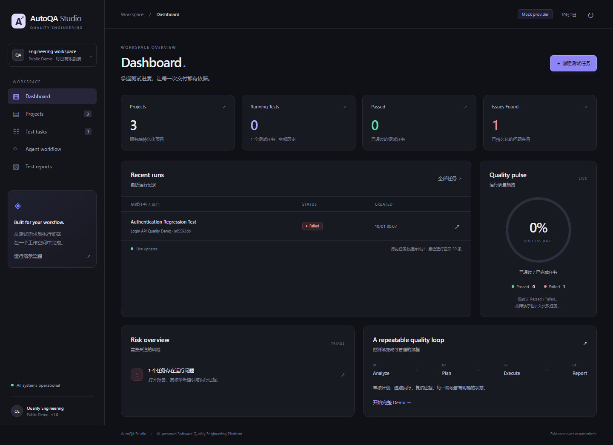
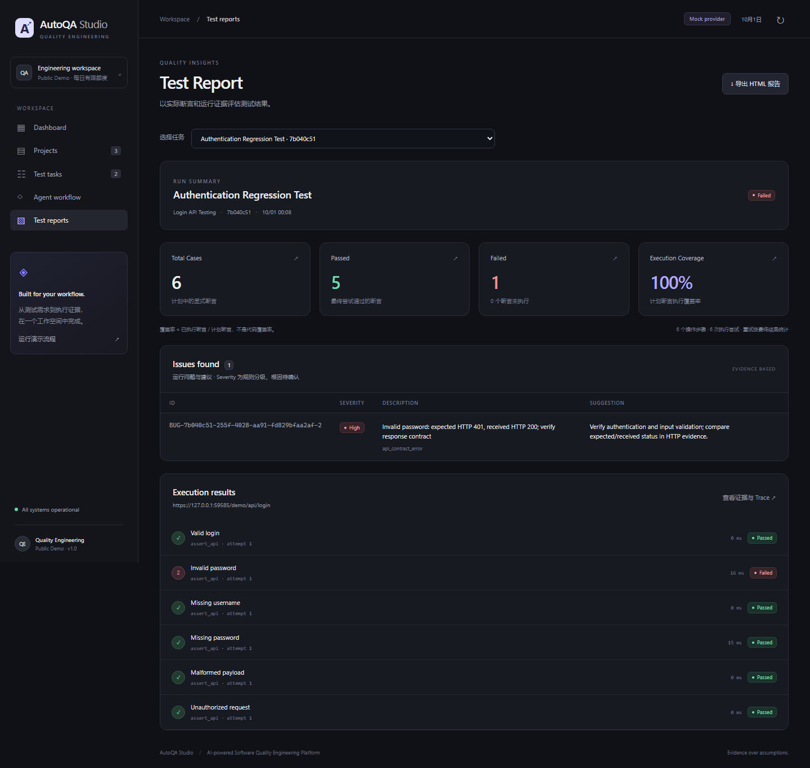
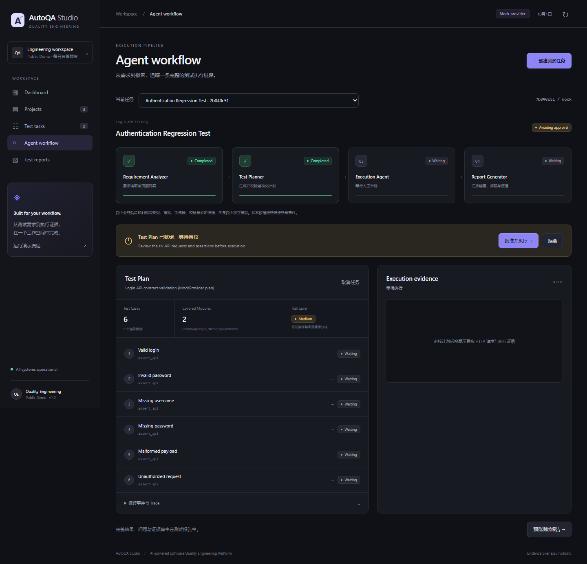
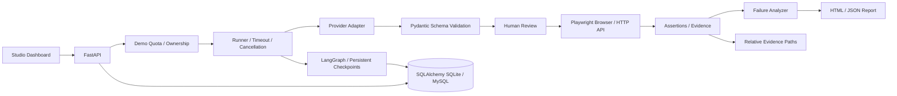
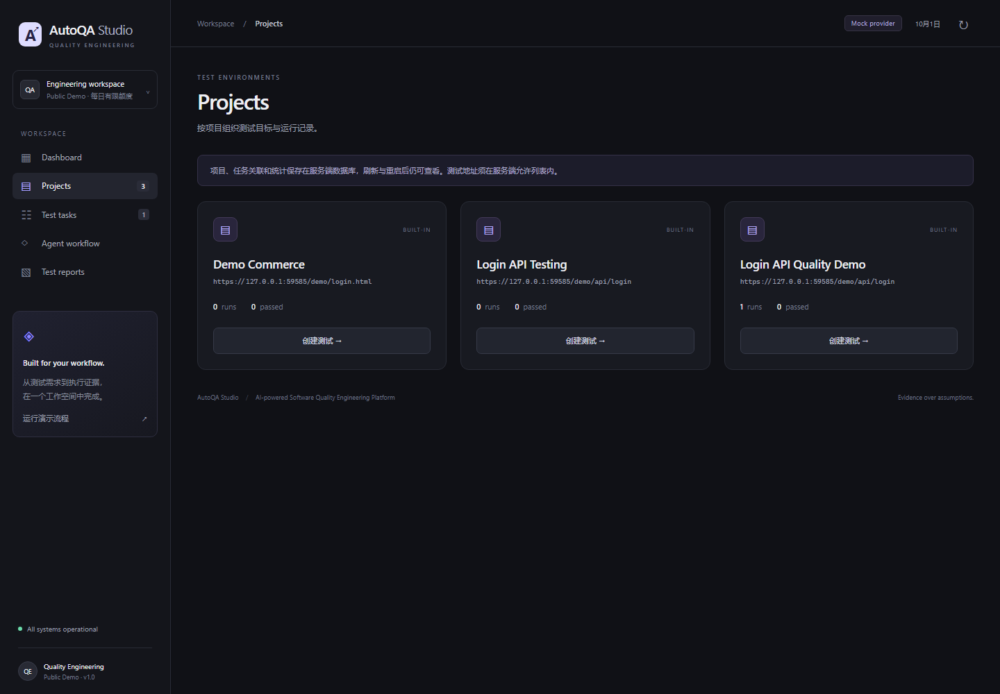

# AutoQA Studio

**AI-powered Software Quality Engineering Platform**

将测试需求、计划审核、受控执行、运行证据和质量报告组织成可追踪的工作流。

[](https://github.com/jayoffans/AutoQA-Agent/actions/workflows/ci.yml)

[60 秒 Demo](docs/demo-script.md) · [部署指南](docs/deployment.md) · [Phase 3 验证](docs/phase3.md) · [API 与本地使用](docs/usage.md)



公开 Demo 默认关闭真实 LLM，使用 MockProvider 生成计划，再执行内置认证接口。页面数据来自后端数据库；截图来自真实浏览器验收实例。尚未发布 Railway 公共地址。

## Demo Scenario

**Login API Quality Demo → Authentication Regression Test**

六类认证契约：正确登录、错误密码、缺少用户名、缺少密码、非法 JSON、未授权访问。内置服务故意接受错误密码，以展示可复核的失败证据。

| 结果 | 数值 |
| --- | --- |
| Test cases | 6 |
| Passed / Failed | 5 / 1 |
| High-severity findings | 1 |
| Planned Assertion Execution Coverage | 100% |

**Execution Coverage = 已执行的计划断言 / 全部计划断言。它不是代码覆盖率，也不表示所有需求都已覆盖。**

Phase 2 已验证真实 DeepSeek 规划、人工审核和网络 HTTP 执行，得到上述结果；可复核 [真实模型记录](docs/phase2-llm-results.json) 与 [Phase 2 报告](docs/phase2.md)。公开 Demo 与启动种子使用 Mock 规划和本地 ASGI 接口执行，证据中标注来源，不声称是本次真实模型调用。



## Workflow

Requirement Analyzer → Test Planner → Schema Validation → Human Review → Execution Agent → Failure Analyzer → Report Generator。

先检查计划的六类场景和预期状态，再批准执行。Workflow 保存每个阶段的状态、输入输出和时间；Finding 引用预期 / 实际 HTTP 响应。API 审批计划可以在重启后继续，浏览器中途会话丢失后需要新任务。



## Architecture



SQLite 使用本地 checkpoint 文件；MySQL 使用 SQLAlchemy 图检查点表。业务数据、配额、报告均持久化。当前调度器和活动浏览器位于单进程中，部署使用一个 worker / replica。

## Features

- Dashboard、Projects、Test Tasks、Agent Workflow、Findings 与 Report。
- Provider Adapter 支持 OpenAI、DeepSeek、兼容接口和 Mock；真实 provider 失败不自动切换 Mock。
- 浏览器导航、输入、点击、断言、截图和 Trace；受控 API 六场景契约测试。
- 人工计划 / 关键步骤审核、任务取消、限次只读重试、超时和并发限制。
- 服务端项目、案例、执行结果、Workflow、Finding 和报告持久化。
- 空任务库自动初始化标准 Demo，固定种子 ID，重复启动不新增重复数据。



## Engineering Highlights

| 工程点 | 实现与验证 |
| --- | --- |
| Provider Adapter | API 调用与执行分离；Mock 只规划，不虚构执行结果 |
| Schema Validation | 强制六类 API 场景、契约状态码和浏览器显式断言 |
| Human Review | 审核完整计划和敏感步骤，拒绝时保留历史 |
| Persistent Workflow | 阶段输入输出、UTC 时间、图检查点、重启恢复语义 |
| Evidence-based Findings | HTTP 预期 / 实际状态、浏览器事件与证据；根因标记待确认 |
| SQLite / MySQL | 方言转换、事务、JSON、Boolean、外键、LONGTEXT 与配额行写锁 |
| CI | Ubuntu pytest、Ruff、JS 语法、浏览器验收及 MySQL 服务 job |
| Browser Verification | 原有 12 项 UI 验收，加公开 Demo 的 8 项浏览器检查 |
| Docker Deployment | Linux 镜像、非 root 用户、动态 PORT、独立健康检查 |

## Tech Stack

Python 3.11+ · FastAPI · Uvicorn · Pydantic · SQLAlchemy · PyMySQL · LangGraph · HTTPX · Playwright / Chromium · 原生 HTML / CSS / JavaScript · pytest · Ruff · GitHub Actions · Docker。

依赖范围见 [pyproject.toml](pyproject.toml)，锁定安装依赖见 [requirements.lock](requirements.lock)。Chrome DevTools MCP / Langfuse 可选，本地使用说明见 [docs/usage.md](docs/usage.md)；公开 Demo 禁用 MCP。

## Testing

Phase 2 基线：**37 automated tests passed · 12 browser UI checks passed**。

Phase 3 结果见 [验证报告](docs/phase3.md)：新增生产安全、配额并发、种子幂等、健康检查、MySQL URL / DDL 和图检查点恢复测试。浏览器检查覆盖 390 / 768 / 1440 px，并保存真实产品截图。MySQL runtime 的本机跳过记录不会被计为通过；新增 CI MySQL job 的结果需在实际运行后确认。

```bash
pytest -q
ruff check autoqa tests scripts
node --check autoqa/static/app.js
node --check autoqa/static/components.js
node --check autoqa/static/studio-model.js
python scripts/validate_production.py
python scripts/validate_deployment.py
python scripts/verify_phase3.py
python scripts/audit_secrets.py
```

## Deployment

Railway 从 GitHub 使用仓库根 Dockerfile 构建，启动命令 **`python -m autoqa`**。ASGI server 读取 `HOST=0.0.0.0` 和平台 `PORT`。`GET /health` 返回 `{"status":"ok"}`，不依赖 LLM。Docker / Railway 配置已检查，本轮没有实际部署。

公开部署：`AUTOQA_ENV=production`、`DEMO_MODE=true`、`DEMO_LLM_ENABLED=false`、`DEMO_DAILY_LIMIT=20`、`DEMO_IP_LIMIT=3`；配置 `DATABASE_URL` 为 Railway MySQL 引用。MySQL 业务数据与图检查点保存在数据库中，证据目录仍需持久卷。SQLite 还需持久化数据库和检查点文件。

完整环境变量、卷权限、手动步骤和已知限制见 [Railway 部署指南](docs/deployment.md)。

## Security

公开用户可以浏览标准示例、创建有限数量的内置 API 任务、审核自身计划并查看 Workflow / Finding / Report。系统种子只读；不开放外部目标、任意步骤、项目修改、Provider 密钥编辑、调试接口、shell、文件浏览或原始 artifact 下载。

全局与来源额度在同一数据库事务中扣减，取消、失败和重启不退还额度，UTC 次日重置。访客归属使用随机 HttpOnly / Secure / SameSite cookie。来源使用 socket peer，忽略用户可伪造的转发头；反向代理后的访客可能共享来源额度。这是有限规模展示，不提供多租户或抗 DDoS 保证。

生产模式关闭 Debug 和 OpenAPI 调试页面；错误与日志不输出密钥、内部异常文本或服务端文件路径。Git / Docker 忽略 `.env`、数据库和日志。当前可达 Git 历史未检测到已知本地密钥或常见真实 token；检查范围与局限见 [Phase 3 报告](docs/phase3.md)。

## Quick Start

### Linux / macOS

```bash
python3 -m venv .venv
source .venv/bin/activate
pip install -r requirements.lock
pip install --no-deps -e .
python -m playwright install --with-deps chromium
LLM_PROVIDER=mock python -m autoqa
```

默认开发模式监听端口 8765。若需要本地体验公开限制和种子数据：

```bash
AUTOQA_ENV=production DEMO_MODE=true DEMO_LLM_ENABLED=false python -m autoqa
```

正式公网生产应通过 HTTPS 访问，以便 Secure 访客 cookie 正常工作。本地 development 可用 `DEMO_MODE=true` 体验完整页面；HTTPS 生产浏览器验证脚本会创建一次性证书与隔离数据库。

### Windows

本地运行 `start.cmd -Setup` 首次安装，之后运行 `start.cmd`。手动方式使用 `.venv\Scripts\python.exe -m autoqa`；启动脚本仅用于本地，不参与 Railway 生产启动。

### Seed

```bash
python scripts/seed_demo.py
```

种子脚本和公开 Demo 的首次启动共用同一实现。非空任务库不批量插入示例；已有种子重复启动只校验 / 补全报告。它使用受控缺陷 fixture 实际计算结果，而不是把计数写在前端 JavaScript 中。
