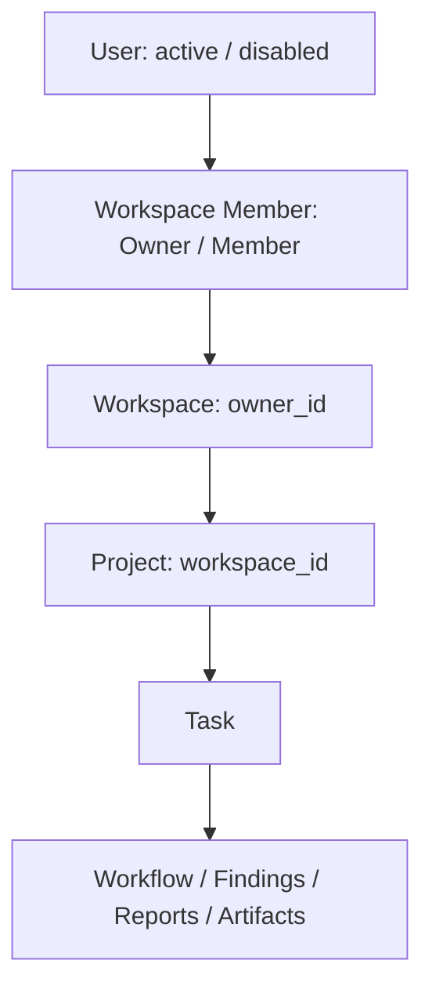
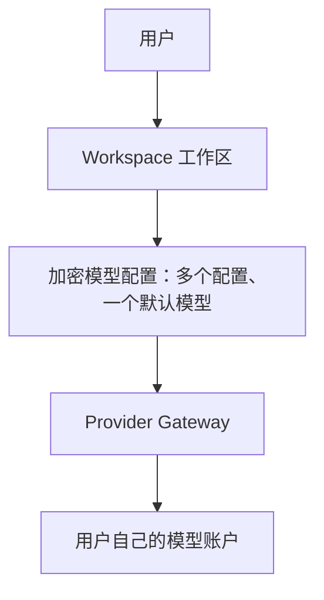

# AutoQA Studio

Phase 6-2-B：工作区 BYOK 模型配置中心，支持多个加密配置、单默认模型与最小连接测试。中文首次使用引导直接进入配置中心，保存后继续下一步。本阶段未扩展首次测试、OpenAPI 或 Web 测试流程。验收见 [模型配置中心报告](docs/phase6-2b.md)；已有引导见 [Phase 6-2-A 报告](docs/phase6-2a.md)。

面向真实 Web / API 项目的 AI 软件测试工作区：解析需求、生成计划、人工审核、受控执行、保留证据与报告。

[](https://github.com/jayoffans/AutoQA-Agent/actions/workflows/ci.yml)

**AutoQA 不提供模型额度。真实模型请求由用户自行配置 Provider API Key，费用计入用户自己的 Provider 账号。**

[Production 部署](docs/production-deployment.md) · [Phase 6-1 认证与隔离验收](docs/phase6-1.md) · [Phase 5 验收与限制](docs/phase5.md) · [旧版使用文档](docs/usage.md)

## Live Demo

[公开体验 AutoQA Studio](https://autoqa-studio-production.up.railway.app/)

Demo 使用 `AUTOQA_MODE=demo`，MockProvider 生成测试计划，执行内置 Login API 真实 HTTP fixture。示例故意接受错误密码，得到 6 个用例、5 个通过、1 个失败。示例 Finding 与报告仅用于 Demo，不代表正式用户的测试结果。

现有线上 Demo 本轮没有部署、清空或修改。Git 历史和测试 fixture 保留。

## Production Use

正式部署必须明确设置 `AUTOQA_MODE=production`，并连接**新的独立数据库**。第一次打开为登录 / 注册入口；注册自动创建个人工作区，项目、任务、问题和执行数全部为 0。

用户流程：

1. 创建 Web 或 API 项目，设置测试环境及 Base URL。
2. 在“设置 / 模型服务”添加 DeepSeek、OpenAI 或 OpenAI 兼容服务，填写模型名称、服务地址和自己的 API 密钥。保存后可测试连接、设为默认或删除。
3. API 项目导入 OpenAPI URL / JSON / YAML，或手动配置接口并选择操作；Web 项目输入目标 URL 和自然语言目标。
4. 检查 AI 计划的测试目标、范围、前置条件、输入和预期结果；修改、增删用例或重新生成。
5. 人工批准后执行，查看每个用例的预期 / 实际、状态、耗时、证据、问题与历史报告。

默认生产操作界面为简体中文，支持 English 切换；文案集中在 `autoqa/static/locales/zh-CN.json` 与 `en-US.json`。服务端错误和导出 HTML 报告目前主要使用中文。旧公开 Demo 界面保持兼容。

用户、Workspace 与 Owner / Member 关系持久化；每个项目属于一个工作区，任务及 Workflow / Finding / Report / Artifact 通过项目继承访问范围。修改 URL / ID 或 `X-Workspace-ID` 不能跨工作区访问数据。Owner 管理模型配置和成员，Member 可以协作测试。

没有模型配置时显示“尚未配置模型服务”。Production 不读取全局开发者模型 Key，不回退 Mock。模型认证 / 额度 / 网络错误作为执行错误保留，不伪装成业务断言失败。

## Authentication Architecture



注册接受 `email`、`password`、`nickname`，同一事务创建 User、个人 Workspace、Owner 成员关系和登录会话。邮箱统一小写且唯一；密码采用带随机盐的 scrypt（N=16384、r=8、p=5），符合 [OWASP 的 16 MiB scrypt 配置](https://cheatsheetseries.owasp.org/cheatsheets/Password_Storage_Cheat_Sheet.html)。保留 Phase 5 密码验证，旧哈希在成功登录时升级。用户响应显式列出基本信息，不包含 password_hash。

| API | 行为 |
| --- | --- |
| `POST /api/auth/register` | 注册并自动登录，返回 user、access_token、refresh_token、csrf_token |
| `POST /api/auth/login` | 邮箱 / 密码认证，返回同样的令牌及用户信息 |
| `POST /api/auth/refresh` | JSON refresh_token 或浏览器 refresh cookie，轮换为新的令牌对 |
| `POST /api/auth/logout` | 撤销当前会话，已签发 access 和 refresh 均失效，清除 cookie 和会话模型配置 |
| `GET /api/auth/me` | 当前用户及所属 Workspace；需要有效 access token |
| `GET /api/auth/csrf` | 验证 refresh cookie 后返回 CSRF，供页面重新打开时恢复登录 |

JWT 使用 PyJWT，固定 HS256，验证签名、issuer、audience、exp、iat、nbf 与 token type；必需 claims 采用 [PyJWT 的 require 配置](https://pyjwt.readthedocs.io/en/stable/api.html)。access 有效期 15 分钟；refresh 最长 7 天，刷新不会延长当前会话的绝对过期时间。每次刷新使用数据库 compare-and-swap 更新 refresh_token_hash，同一令牌并发刷新仅一个成功。数据库保存 SHA-256 refresh 哈希和会话标识哈希，不保存原始令牌。每次生产请求还验证会话、用户 active 状态和成员关系，因此退出、禁用或移除成员后访问立即失效。

JWT 签名密钥通过 HMAC-SHA256 从现有 AUTOQA_SECRET_KEY 按独立用途派生；不增加部署必需变量，AES-GCM 信封格式保持兼容。不要将 Token 放在 URL 或日志中。API 客户端使用 `Authorization: Bearer <access_token>`；浏览器使用 HttpOnly、SameSite=Strict cookie，在 Production HTTPS 上设 Secure，写操作校验 Origin / CSRF。refresh cookie 仅发送到 `/api/auth`。浏览器不将令牌写入 localStorage，access 过期时自动刷新。

Production `/api` 业务入口统一生成 CurrentUser；`X-Workspace-ID` 只能选择当前用户已加入的 Workspace，不能用作授权证明。项目按 workspace_id 查询，任务通过 TaskMetadata → Project 检查归属；Workflow、Finding、Report、SSE 与 Artifact 共用任务归属检查。跨工作区返回 404，不披露资源名称或内容。Artifact 没有公开文件目录，文件名经过校验，路径必须位于当前任务目录；拒绝路径遍历及符号链接。退出或切换工作区时前端清除数据并丢弃旧请求结果。

Owner 可配置模型及添加已注册的 Member；本阶段不实现所有权转移、额外角色、邮件、支付、企业 RBAC 或新的 Onboarding 流程。Demo 保持公开体验和 Seed，使用原有独立入口。

## BYOK Architecture



**AutoQA 不提供模型额度。** 所有模型请求（包括测试连接）由用户自己的模型账户计费，Production 不使用开发者环境变量中的 Key，也不回退到 MockProvider。

`AUTOQA_SECRET_KEY` 是随机 32 字节的服务端主密钥。用户输入 API 密钥 → FastAPI → **AES-256-GCM** → 数据库 `encrypted_api_key`；每次加密使用独立的 12 字节 nonce，GCM 自带认证标签。新持久配置的 associated data 同时绑定工作区与配置 ID，防止密文在记录或工作区之间交换。旧配置保持原工作区绑定信封，迁移不解密或重写密文。API 与页面只返回 `sk-********1234`，不返回完整密钥或密文。删除配置清除数据库中的密文；新建配置可更换密钥。

一个工作区可保存多个统一结构的 `ProviderConfig`：`id`、`workspace_id`、`provider`、`model_name`、`base_url`、`encrypted_api_key`、`api_key_hint`、`is_active`、`created_at`、`updated_at`。另有连接状态与内部默认槽位。数据库的唯一默认槽位和 CHECK 约束保证每个工作区最多一个默认模型；写操作按工作区串行化。新增配置自动成为默认，删除默认配置后启用最近添加的备用配置。配置列表、删除、切换和测试都通过当前用户的工作区成员关系及 `workspace_id` 查询；只有 Owner 可以更改配置或发起付费连接测试。

DeepSeek 默认地址为 `https://api.deepseek.com`，推荐填写 `deepseek-chat`；OpenAI 默认地址为 `https://api.openai.com/v1`，模型由用户填写；OpenAI 兼容服务需自定义服务地址与模型名称。地址校验继续使用现有网络策略与连接时 DNS 固定，默认只允许公共 HTTPS，禁用重定向，不将 API 密钥放入 URL。

| API | 行为 |
| --- | --- |
| `GET /api/settings/providers` | 当前工作区配置列表，仅返回掩码及状态 |
| `POST /api/settings/providers` | 接受 provider、model、api_key、base_url；加密保存，新配置设为默认 |
| `DELETE /api/settings/providers/{id}` | 删除当前工作区配置；删除最后一个后恢复未配置状态 |
| `POST /api/settings/providers/{id}/test` | Gateway 创建临时 HTTP 客户端，发送一次最小模型请求 |
| `POST /api/settings/providers/{id}/activate` | 切换工作区默认模型 |

连接测试使用 `/chat/completions`，仅一条消息、`max_tokens=1`，15 秒超时与 64 KiB 响应上限。成功返回 `{"status":"success","model":"deepseek-chat"}`；失败统一返回中文说明，不返回异常堆栈、服务商错误正文或密钥。客户端在请求后关闭，解密密钥仅在请求局部使用。连接状态为待测试 / 成功 / 失败；仅成功探测后工作台显示“✓ 模型已连接”。保存配置更新 `model_configured=true`，在引导第 2 步保存后继续项目创建，不标记第一次测试已完成。

旧 `/api/provider` GET / PUT / DELETE 和 `/api/provider/test` 保持兼容，业务调用继续经 Provider Gateway 选择当前默认模型；现有 Provider 适配器与 Agent 调用逻辑保持不变。

支持两种模型配置保存方式：

- **仅本次使用**：加密配置只存在当前服务进程内存，绑定用户登录会话与工作区，退出 / 过期 / 重启后不可使用。列表标识 `id=session`，可测试或删除。此方式会临时覆盖当前会话的工作区默认模型。
- **保存到工作区**：数据库保存加密配置，工作区成员共享模型服务，费用计入该工作区配置的 Provider 账号。

密钥解密只在 Provider 请求局部使用，完成后清除对象中的引用；这不是对 Python 内存的物理擦除保证。Provider Gateway 使用用户提供的 Base URL / Model / Key，不配置免费真实模型额度。

环境认证 Header、Token、Password、自定义敏感变量及保存的测试账号也通过 AES-GCM 加密。计划只保存 `{{TOKEN}}` / `{{USERNAME}}` / `{{PASSWORD}}` 等占位符。临时账号仅本次任务使用，任务完成后清除内存密文。已知秘密会从输出、日志、DOM 与响应证据中移除。Production 禁用 Playwright Trace；配置运行变量时不保存截图，避免目标页面把密码回显到图像中。

## Testing Architecture

保留 FastAPI、SQLAlchemy、LangGraph 和 Playwright。Production 复用既有浏览器工作流、执行器、Store 和报告系统，为 API 项目加入通用接口执行器。

API 支持 OpenAPI 3.x / Swagger 2.0 的 path、method、parameters、JSON request body、response schema 和本地 `$ref`，不再限定 Login API。远程 / 循环引用需预先打包；当前不是完整的 OpenAPI 兼容性实现，不支持 multipart、OAuth 自动取令牌、递归 schema 和任意复杂 JSON Schema 方言。

Web 测试观察用户真实页面、规划可审核动作、执行断言并保存证据。任务不会默认指向 AutoQA 页面。生产模式所有计划，包括只读断言，都必须人工批准；关键步骤可以继续单独审批。多用例 Web Suite、自动浏览器登录发现与复杂跨域业务流程尚未完善。

业务失败来自实际执行断言。系统 / Agent / 网络异常记为 `system_error`。Finding 显示受影响目标、预期、实际和证据；修复提示标注“AI 分析建议”，`root_cause_confirmed=false`。当前故障归类和提示仍包含规则逻辑，不能视为已证实的后端根因。

公网目标采用 HTTP(S) 检查、DNS 解析、公网 IP 校验和连接 IP 固定，校验重定向并限制响应大小。默认禁止 localhost、私有 IP、link-local、metadata、file URL、任意 shell / 脚本动作与服务器文件访问。自托管允许内网需要显式 opt-in；metadata IP 始终禁止。运行测试须使用已获授权的环境和测试账号。

## Database Migrations

Alembic 替代仅依赖 `create_all` 的建表方式：

- `0001_legacy`：识别并补齐旧结构，不删除旧行。
- `0002_product`：users、workspaces、workspace_members、user_sessions、provider_configs、environment_configs、api_contracts、deployment mode marker，以及项目 ownership / 类型 / 环境字段。
- `0003_auth`：用户 nickname / is_active / updated_at、工作区 owner_id / updated_at、成员 id / created_at、会话 refresh_token_hash / created_at。回填旧成员及 Owner，保留已有密码、工作区名称和项目。历史无成员工作区允许 owner_id=NULL，历史 Demo 项目继续保持未归属；新注册与项目创建必有有效归属。
- `0004_onboarding`：保存新用户首次使用引导进度，老用户不创建引导记录。
- `0005_provider_center`：`provider_configs` 从工作区主键改为配置 ID 主键，保留工作区索引；`model` 改为 `model_name`，`key_mask` 改为 `api_key_hint`，增加默认状态、连接状态与时间字段。逐条原样复制旧密文，旧配置 ID 使用原 workspace_id，保持解密兼容。默认槽位唯一约束在 SQLite / MySQL 均适用。

旧项目保持 `workspace_id=NULL`，不会自动分配给新用户。数据库模式标记阻止 Demo / Production 复用数据库；正式模式拒绝接管旧 Demo 业务库。迁移前备份；没有自动破坏性 downgrade。

Phase 5 的旧 cookie 会话保留记录，但不能用于新 JWT 认证，升级后用户需要重新登录；业务数据不受影响。启动使用 Alembic，不调用 create_all。账号禁用目前通过维护者更新 is_active，没有新增管理后台。

## Self-hosting

```bash
pip install -r requirements.lock
pip install --no-deps -e .
python -m playwright install chromium
# 设置 .env：production 模式、主密钥、独立数据库、HTTPS 域名
python -m alembic upgrade head
python -m autoqa
```

Docker 与 Railway 环境变量、Volume、数据库及 HTTPS 配置见 [正式版部署指南](docs/production-deployment.md)。不要复制开发者模型 Key。当前要求单进程 / 单副本；临时配置和运行队列不能跨进程共享。

## Production Compatibility

支持 **SQLite development** 与 **MySQL production**。数据库使用 **Alembic**，现有迁移链为
`0001_legacy → 0002_product → 0003_auth`。Production 必须显式注入 `DATABASE_URL` 和
`AUTOQA_SECRET_KEY`；没有默认生产数据库地址或开发密码。MySQL 迁移与生产连接统一使用 UTC。

独立生产容器入口为 `compose.production.yaml`。先在本机未跟踪的 `.env.production` 中配置
`AUTOQA_MODE=production`、`AUTOQA_ENV=production`、随机主密钥、显式 MySQL URL，以及
`MYSQL_DATABASE`、`MYSQL_USER`、`MYSQL_PASSWORD`、`MYSQL_ROOT_PASSWORD`，然后执行：

```bash
docker compose --env-file .env.production -f compose.production.yaml build
docker compose --env-file .env.production -f compose.production.yaml up -d --wait
```

容器接受 `AUTOQA_MODE`、`AUTOQA_ENV`、`AUTOQA_SECRET_KEY`、`DATABASE_URL`、
`AUTOQA_DATA_DIR`、`AUTOQA_ARTIFACT_DIR` 环境变量。默认命名卷分别保存 MySQL 数据、
`/app/data` 与 `/app/artifacts`；自定义目录应位于这两个应用卷内。重建时使用 `down`，保留卷；
`down --volumes` 会删除数据。生产浏览器需要 HTTPS；验收使用本机临时 TLS 入口。

CI `auth-mysql` 执行空库迁移、SQLite / MySQL 认证与权限测试、服务重启与 Chromium 验收。
`docker-production` 实际执行 Docker build、Compose up、`GET /health`、环境变量注入、
容器重建后的卷持久化与 HTTPS 浏览器流程。测试使用随机临时凭据和本地 Mock HTTP Provider，
不访问真实模型、不修改生产 Provider 的 BYOK 行为。

**Container: Docker verified** — 已在 GitHub Actions 的真实 Docker / MySQL 环境完成上述容器验收；
证据与具体限制见下方报告。

现有 `compose.yaml` / `docker-compose.yml` 继续作为 Demo 入口，`AUTOQA_MODE=demo` 与 Seed
保持兼容。本阶段没有部署 Railway、修改公开 Demo 或合并 main。

具体实测结果及未覆盖范围见 [Phase 6-1.5 验收报告](docs/phase6-1.5.md)。

## API Testing Workflow

OpenAPI → Endpoint Parsing → Test Planning。

Phase 6-2-C-1-A 建立稳定的 API 测试输入：创建 **API 测试项目**（可暂不填写 Base URL），
在项目详情点击 **API 测试**，上传 `.json`、`.yaml` 或 `.yml` 文档。
成功后显示 **解析完成**、接口数量以及 method / path / summary / 参数与请求响应结构。
支持 OpenAPI 3.0 / 3.1 / 3.2 和 Swagger 2.0；使用 Prance、openapi-spec-validator 与 SchemaPath，
导入本身不调用模型或目标接口。Phase 6-2-C-1-B 已开放 **生成测试计划**，使用工作区 BYOK 模型。

上传文件上限为 1,000,000 bytes（1 MB），仅接受 UTF-8。文档与接口全部绑定当前 Workspace；
数据库复合外键保证 Project / ApiSpec / ApiEndpoint 归属一致。原始内容只保存到数据库，
不提供文件下载或 raw-content API。允许文档内 JSON Pointer 引用，Schema 引用（含递归 Schema）
保留在结构数据中；外部 URL / 文件引用、schema 资源 ID、动态引用、YAML 锚点 / 别名被拒绝。
单份文档最多 1000 个接口、4 MB 解析结构，另有深度 / 节点数限制。

| API | 用途 |
| --- | --- |
| `POST /api/projects/{project_id}/api-specs/upload` | multipart `file` 上传，返回 `spec` 和 `endpoint_count` |
| `GET /api/projects/{project_id}/api-specs` | 列出规范元信息及其接口数量 |
| `GET /api/projects/{project_id}/api-endpoints` | 列出已解析接口、参数与请求 / 响应结构 |
| `DELETE /api/projects/{project_id}/api-specs/{id}` | 删除规范及关联接口 |

Alembic 新增 `0006_api_import`，不修改历史 migration。可用 `python -m alembic upgrade head` 升级；
新 API 只注册到 Production。现有 Demo 与较早契约 / 执行流程继续保留，新导入数据已连接 AI Planner；执行与报告尚未接入。
新增测试位于 `tests/test_api_import.py`、`tests/test_api_import_compat.py`、`tests/test_api_import_browser.py`。
运行结果与限制见 [Phase 6-2-C-1-A 报告](docs/phase6-2c-1a.md)。

## AI Test Planner Architecture

```text
OpenAPI
   ↓
Endpoint（ApiEndpoint + 文档中的本地 schema / security 定义）
   ↓
LLM Planner（TestPlannerAgent → ProviderGateway → 用户的 BYOK Provider）
   ↓
Pydantic Schema + 接口归属 + 四类覆盖校验
   ↓
TestPlan + TestCase（事务保存）
```

在 API 测试页面选择接口文档，配置并启用模型后点击 **生成测试计划**。页面显示生成状态、
测试数量、正常 / 异常 / 边界 / 安全分类统计；详情页展示优先级、说明、中文步骤和预期结果，刷新后仍可查看。
该流程只规划，描述性 steps 不会交给 HTTP 或浏览器执行器。

`TestPlannerAgent` 不直接实例化 OpenAI / DeepSeek；所有模型请求必须通过现有 Provider Gateway。
Gateway 使用工作区或当前会话的加密配置，不回退到环境凭据或 MockProvider，返回前去除密钥回显。
Prompt 要求仅返回 JSON，文档内容按不可信数据处理，凭据使用占位符，未定义的约束要注明假设。
`PlannerOutput` / `PlannedCase` 禁止额外字段，校验字符串长度、步骤、四类 category 和 P0–P3 priority；
每个接口必须有四类案例，接口 ID 必须属于该批次，禁止同接口重名。

新增 `TestPlan` / `TestCase` 采用独立的 `ai_test_plans` / `ai_test_cases` 表，避免与 Demo 的历史同名业务模型冲突。
计划保存 `workspace_id / project_id / api_spec_id / provider / model / created_by` 和时间戳，状态支持
`draft / generating / ready / failed / approved`；本阶段生成流程只使用 `generating → ready / failed`。
Case 保存接口关联、名称、分类、优先级、说明、JSON steps、预期结果和创建时间。
复合外键约束计划文档归属和 Case 工作区；Agent 进一步验证 Case 只能引用计划所选文档的接口。
增量迁移 `0007_test_planner` 已包含在 wheel 数据文件中，可执行 `python -m alembic upgrade head`。

| API | 行为 |
| --- | --- |
| `POST /api/projects/{project_id}/test-plans/generate` | 同步生成并返回 201；可传 `{"api_spec_id":"…"}`，省略时使用最新文档 |
| `GET /api/projects/{project_id}/test-plans` | 当前项目的计划、状态、数量及分类统计 |
| `GET /api/test-plans/{id}` | 当前工作区内的计划与分类统计 |
| `GET /api/test-plans/{id}/cases` | 当前工作区内的结构化用例 |

无模型 / 无文档返回中文 422；跨工作区或归档项目返回 404。模型超时、JSON 非法、Schema / 覆盖失败、
保存异常返回固定中文 502，`detail.message` 为友好提示，`detail.plan_id` 可用于查看失败计划。
先持久化 `generating`，所有批次全部校验后才一次保存 Case 和 `ready`；失败计划不包含部分案例。
取消请求或服务重启后将中断的 `generating` 标记为 `failed`。不记录原始 LLM 输出或异常信息。
已关联计划的文档删除返回中文 409，保留计划依赖的文档和接口。

当前限制：每份文档最多规划 20 个接口，每批 2 个，最多 12 个案例 / 接口，单批上下文最大 200 KB，
整份计划生成超时 120 秒。重新生成会创建新计划；没有队列、断点续生成或自动重试。
服务按当前单进程部署方式恢复生成状态，多 worker 的持久化任务租约是后续工作。
`approved` 保留为数据状态，本阶段未增加审批 API；未新增 API 执行、Playwright 执行或测试报告。

专项验证：`pytest tests/test_test_planner.py tests/test_test_planner_compat.py tests/test_test_planner_browser.py -q`。
CI 全部使用 Mock HTTP Transport 和假密钥，SQLite / MySQL 执行相同迁移与持久化契约，真实 Chromium 检查
生成态、详情、刷新、移动端和内容转义。没有真实模型调用。结果见 [Phase 6-2-C-1-B 报告](docs/phase6-2c-1b.md)。

## Execution Architecture

Phase 6-2-C-1-D completes API execution without model calls:

```text
Approved TestPlan → Execution Preview → ApiExecutor / pinned httpx
                                       ↓ deterministic HTTP + JSON assertions
                                  TestExecution → TestRun Summary
```

Human review freezes the target, requests, expected HTTP status and optional JSON assertions.
`TestCase.execution_config` retains its AES-GCM envelope; older status-only configurations load with
an empty assertion list. Migration `0009_execution_assertions` adds only nullable Execution `status`
and `result_data`, plus outcome constraints. Existing migrations and historical evidence are unchanged.
The independent `api_test_runs` / `api_test_executions` tables retain workspace/plan/case foreign keys
and the database-backed single active run per plan.

| API | Behavior |
| --- | --- |
| `GET /api/test-plans/{id}/execution-preview` | Offline, redacted request and assertion preview |
| `POST /api/test-plans/{id}/approve` | Atomic review of all cases; configuration becomes immutable |
| `POST /api/test-plans/{id}/execute` | Execute approved configuration; return a new TestRun with 201 |
| `GET /api/test-plans/{id}/runs` | Historical runs with derived summaries |
| `GET /api/test-runs/{id}` | Selected run, request/response and independent assertion evidence |
| `POST /api/test-runs/{id}/rerun` | Full rerun using approved configuration; new run and execution IDs |

Example reviewed case (submit every case exactly once):

```json
{
  "cases": [{
    "case_id": "case-uuid",
    "request_data": {"path_params": {}, "query": {}, "headers": {}, "json_body": null},
    "expected_status": 200,
    "assertions": [
      {"type": "json", "path": "data.success", "operator": "equals", "expected": true},
      {"type": "json", "path": "data.token", "operator": "exists"},
      {"type": "json", "path": "users.0.id", "operator": "type", "expected": "integer"}
    ]
  }]
}
```

Paths are dotted exact keys with numeric array indices; no JSONPath expressions, wildcards or code.
`exists` accepts a present null. Equality separates booleans from numbers, treats 1 and 1.0 as equal,
ignores object key order and preserves array order. Types are string, number, integer, boolean, object,
array and null. Each case permits 32 JSON assertions, paths of 256 characters / 32 segments.
No JSON assertions are automatically inferred from prose or supplied by a model during execution.

Execution outcomes are `passed`, `failed` (completed HTTP with an assertion mismatch) and
`execution_error` (DNS, timeout, TLS, connection, policy, response limit or internal failure).
HTTP 500 can pass when expected. Redirect responses fail even if their status was expected; they
are never followed. Run status retains the existing running/result/interrupted architecture;
`summary.lifecycle` separates running/interrupted/completed from nullable `summary.outcome`.
Summaries count passed, failed, execution_error and pending from saved executions. Interrupted or
in-flight cases without evidence remain pending. Historical top-level counters stay unchanged;
nullable old Execution statuses are inferred only on read with `classification_inferred=true`.
No historical assertion evidence is invented.

Production UI supports JSON assertion review, selected historical run details and explicit rerun.
Rerun never reconstructs credentials from redacted requests and never overwrites a previous run.
An active run or changed project target is rejected with 409. Rerun can repeat business writes;
there is no automatic retry, partial rerun, response-variable chaining or transactional rollback.

SSRF remains strict even when legacy private-target settings are enabled: public IPs only,
complete DNS-set validation and connection-time IP pinning with original Host/SNI. URL userinfo,
base/endpoint path traversal, Host/transport header overrides, redirects and environment proxies
remain blocked. HTTP(S) ports are limited to 80/443/8080/8443. Authentication, workspace and archived
project checks and Cookie CSRF remain shared with Production.

Assertions compare raw responses first. Only then are request/response/error/assertion evidence
redacted and bounded. Sensitive fields are always masked; response secret echoes are hidden using
long, non-common sensitive strings rather than global replacement of short/common values. Malformed
sensitive text bodies are hidden conservatively. HTTP library logging is sanitized only within the
execution context. Assertion display values are limited to 4096 bytes and saved response text to
256,000 bytes; truncation is marked without changing the comparison result.

Limits remain 240 cases/run, 64,000 bytes of reviewed configuration, 256,000 decoded response bytes,
10 seconds/case and 120 seconds/run. Evidence and counters commit after each case. Run cancellation,
storage failures and process recovery preserve completed evidence and use interrupted lifecycle.
The runner remains in-process and serial; startup recovery assumes a single process.

Real socket acceptance uses a controlled HTTP server and the original pinned/real httpx transport.
The localhost exception is a pytest-only exact-target resolver monkeypatch; no production setting,
environment escape hatch or general localhost allowance is added. Default test and production
execution still reject local targets. TLS verification remains enabled.

```bash
pytest tests/test_api_assertions.py tests/test_api_execution.py tests/test_api_execution_socket.py \
  tests/test_api_execution_compat.py tests/test_api_execution_browser.py -q
```

No Phase E analyzer, Finding, Report, Web execution extension or queue is added.
See [Phase D acceptance](docs/phase6-2c-1d.md) and the historical
[Phase C implementation](docs/phase6-2c-1c.md).

## Verification

```bash
ruff check autoqa tests scripts migrations
pytest -q --junitxml=work/test-results.xml
node --check autoqa/static/production.js
node --check autoqa/static/i18n.js
```

保留旧浏览器、Demo、报告、代理限额与数据库测试。新增空 Production、用户 / 工作区 / 对象隔离、BYOK、加密、掩码、无回退、OpenAPI、环境秘密、Alembic 和真实 Chromium 验收。CI 仅使用 fixture Key 和 Mock HTTP，不产生真实模型费用；MySQL 使用独立的 Demo 与 Production 测试数据库。

Phase 6-2-B 专项测试位于 `tests/test_provider_center.py`、`tests/test_provider_center_compat.py` 与 `tests/test_provider_center_browser.py`。安全与 API 用 fake transport，数据库兼容用本地 Mock HTTP Server，浏览器使用假密钥。MySQL CI 运行相同迁移与配置流程，覆盖旧密文升级、多配置、连接、默认切换和删除；不会读取宿主机真实模型 Key。

认证、刷新轮换、并发刷新、跨用户资源隔离及真实 Chromium 双用户流程的本轮结果见 [Phase 6-1 报告](docs/phase6-1.md)。MySQL CI 还验证带 Phase 5 用户、工作区和项目的升级及重新登录。没有真实模型依赖。

完整结果、未实际验收项目和上线前缺项见 [Phase 5 报告](docs/phase5.md) 和 [Phase 6-1 报告](docs/phase6-1.md)。
