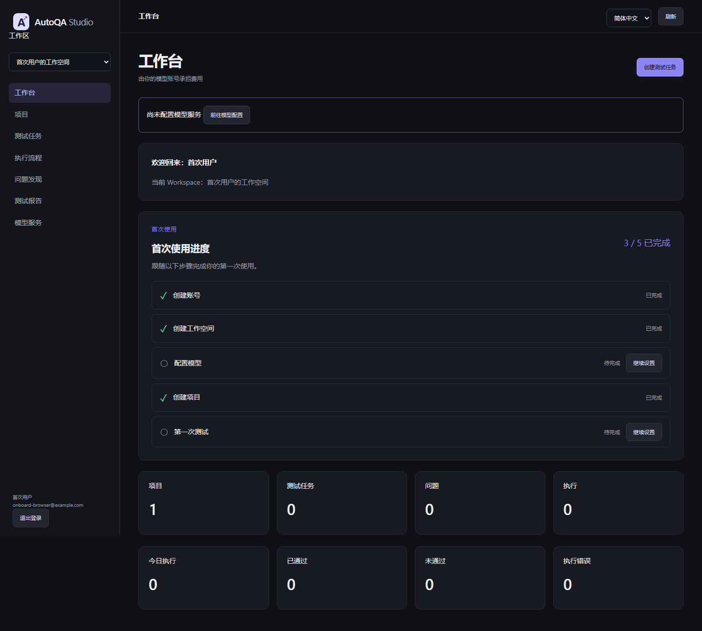
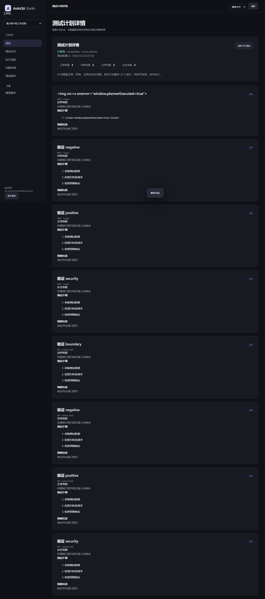

# AutoQA Studio

把 OpenAPI 接口描述转成可审核、可执行、可追溯的 API 测试。AI 负责生成测试计划；每次执行须经人工审核，HTTP 请求和断言按已批准配置确定性运行。

[GitHub 仓库](https://github.com/jayoffans/AutoQA-Agent) · [CI 状态](https://github.com/jayoffans/AutoQA-Agent/actions/workflows/ci.yml)

**English summary:** AutoQA Studio imports OpenAPI contracts, uses the workspace owner's model key to draft test cases, requires human review, then runs deterministic HTTP requests and assertions. It stores evidence and exports HTML/Markdown quality reports.

## 产品流程

~~~mermaid
flowchart LR
    A[OpenAPI Import] --> B[AI Test Planner]
    B --> C[Human Review]
    C --> D[Deterministic HTTP Execution]
    D --> E[Evidence]
    E --> F[Quality Report HTML / Markdown]
    F -. optional .-> G[AI Analyzer]
~~~

AI 生成的是待审核计划，不会直接发起测试请求。人工批准后，HTTP 执行器依据用例中的请求参数、预期状态码和断言发送请求并记录结果。AI Analyzer 可基于已脱敏证据补充分析建议；它不会修改执行结果，建议也不代表已确认根因。

## GitHub 作品展示与本地演示

以 [GitHub 仓库](https://github.com/jayoffans/AutoQA-Agent) 作为唯一对外作品展示入口，不提供在线体验链接。源代码、自动化测试、CI 及技术验收记录均可通过仓库查阅。

截图来自不同阶段的受控测试环境，不代表同一次在线实时测试。

### 本地体验路线

1. 依据下方“本地启动”说明运行项目。默认 Demo 模式可使用内置场景，不必配置真实模型 Key。
2. 查看测试计划、人工审批、执行证据和报告。清楚区分使用 Mock 的规划、真实 HTTP / 浏览器执行与历史受控 Alpha 结果。
3. 要运行完整的 OpenAPI → AI Planner → 人工审核 → HTTP 执行闭环，参照[部署指南](docs/production-deployment.md)建立独立 Production 环境，配置自有模型 Key，并仅测试已授权系统。
4. 参考[演示讲解](docs/demo-guide.md)、[架构说明](docs/architecture.md)、[验证记录](docs/validation.md)。

## 能力与技术栈

- **OpenAPI 导入**：支持 OpenAPI 3.x 与 Swagger 2.0 的常用接口、参数、JSON 请求体和响应结构；仅接受文档内引用，受支持范围和限制以解析器校验为准。
- **计划与审批**：LangGraph 工作流调用用户配置的模型生成结构化计划；用户可编辑用例，批准后执行配置被冻结。
- **HTTP 执行**：基于 HTTPX 逐条发送真实 HTTP 请求，按确定性状态码和 JSON 断言判定通过或失败；网络、认证等执行异常单独报告为 execution error。
- **证据与报告**：保存请求、响应、断言、时间和诊断证据；生成 HTML 与 Markdown 质量报告。证据和日志会进行敏感信息脱敏与长度限制。
- **可选分析**：AI Analyzer 阅读经过筛选和脱敏的证据，输出假设与建议，不改写测试判定。
- **技术栈**：Python 3.11、FastAPI、Pydantic、SQLAlchemy、LangGraph、HTTPX、Alembic、SQLite、MySQL、Playwright / Chromium、Docker Compose、pytest、GitHub Actions。

本地可使用 SQLite；仓库还包含通过 CI 验收的 MySQL 与 Docker 部署路径。

## 生产安全边界

- **BYOK**：用户自行配置 Provider 和 API Key。密钥使用 AES-256-GCM 加密保存，界面仅显示掩码；Production 不读取开发者模型 Key，也不回退到 Mock。
- **人工审批**：计划须经人审核和批准后才能执行；审批后冻结本次执行配置。
- **SSRF 防护**：Production 默认限制为经过 DNS 和公网 IP 校验的 HTTP(S) 目标，阻止私有、环回、链路本地和云 metadata 地址，并限制重定向与响应大小。
- **审计与隐私**：保存执行与审核记录；安全日志、响应和证据对已知敏感值脱敏。证据中可能仍包含目标服务返回的业务数据，使用者应选择适当的测试数据并管理报告访问权限。
- **执行范围**：执行器运行接口请求和受支持的断言，不运行模型生成的 shell、脚本或任意代码。仅测试你获准访问的目标。

## 真实验收与 CI

在独立的受控公网 **Alpha Target** 上，Hardening 后执行 **24 个用例 / 6 个 endpoints**，结果为 **22 passed、2 条预设断言失败、0 execution_error**；安全诊断与报告汇总一致。两条预设失败用于验证失败断言能如实报告。**这是上线前受控 Alpha 执行验收，并非 Production 实例上的 24 Case 实测。**

Production 切换及实际重启后的 HTTPS、登录、OpenAPI 和安全检查分别通过 **62 项**与 **23 项**验收。GitHub Actions 的 Production-ready release 工作流于 [2026-10-05 成功完成](https://github.com/jayoffans/AutoQA-Agent/actions/runs/37274547291)，其中包含 MySQL 与 Docker 验收。上线前的自动化与受控执行验收未调用真实模型账户；Production 已通过部署、重启和持久化检查，但尚未进行真实 BYOK 推理验收。

## 本地启动

以下为 Windows PowerShell 示例。默认配置使用本地 Demo 模式和 SQLite；运行真实模型规划需在本机配置自己的 Provider。Production 与 Demo 必须使用不同数据库。

~~~powershell
py -3.11 -m venv .venv
.\.venv\Scripts\Activate.ps1
Copy-Item .env.example .env
pip install -r requirements.lock
pip install --no-deps -e .
python -m playwright install chromium
python -m alembic upgrade head
python -m autoqa
~~~

打开 http://127.0.0.1:8765 。本地环境变量说明见 [.env.example](.env.example)。

## 自托管部署

仓库提供独立的 Production Compose 配置 [compose.production.yaml](compose.production.yaml)，使用 MySQL 与独立数据、证据 Volume。部署前请准备独立数据库凭据、32 字节随机 AUTOQA_SECRET_KEY、显式 AUTOQA_MODE=production 和 AUTOQA_ENV=production，并在 HTTPS 反向代理后运行。请勿复用 Demo 数据库或 Volume，也不要把任何密钥提交到 Git。

~~~powershell
docker compose --env-file .env.production -f compose.production.yaml build
docker compose --env-file .env.production -f compose.production.yaml up -d --wait
~~~

.env.production 仅保存在部署环境中。主密钥丢失会导致已保存的 Provider 密钥无法解密；单副本运行是当前部署约束。部署前应独立配置数据卷与环境密钥。

## English

AutoQA Studio turns OpenAPI contracts into reviewed API test plans. Users bring their own model credentials; a human approves each plan before deterministic HTTP execution. The product retains evidence and exports HTML/Markdown quality reports, with optional AI analysis clearly separated from test results.
