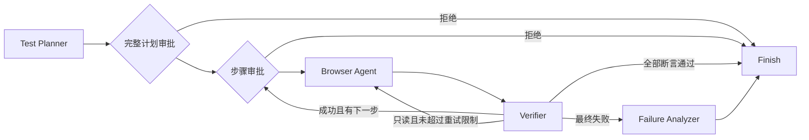

# 架构与执行语义

## 实际状态图

FastAPI 创建任务后立即返回 ID。Runner 使用受限 asyncio 工作队列驱动 `graph.ainvoke`。数据库记录可展示的业务状态；Checkpointer 保存图的执行位置和待审批 interrupt。浏览器句柄不会放进可序列化的图状态。

图状态包括 task_id、request、plan、cursor、attempt、result、evidence、status。每次调用设置唯一 `thread_id=task_id`。审批使用 `Command(resume=True/False)`，而非从头执行任务。

## 重启与恢复

| 中断位置 | 重启后行为 |
| --- | --- |
| 尚未开始执行的完整计划审批 | 保留计划与 interrupt；批准后创建新浏览器，从首个步骤执行 |
| 已完成部分操作的步骤审批 | 保留步骤和审批信息；浏览器已丢失时返回 409，要求检查证据并创建新任务 |
| queued / running | 启动时标记 interrupted；不自动重放提交操作 |

持久化图状态不等于持久化浏览器会话。当前系统不承诺 Exactly Once，也不通过重放所有点击来假装恢复页面。执行期间服务崩溃可能存在「业务操作已发生，结果尚未写入」的不确定窗口，应通过外部测试系统的数据清理或业务幂等键处理。

## 重试与边界

- 只有 navigate、wait、assert_text、assert_visible、assert_url、screenshot 可自动重试。
- click、fill、select、press 失败后不自动重放，即使失败看起来像超时。
- 每次尝试独立落库和保留证据。最终状态由最后一次校验和运行错误决定。
- `max_steps` 在执行前校验，`max_retries` 每个步骤单独计数。
- 单步时间限制用于浏览器操作；整个图调用有独立任务超时。审批等待不会占用图调用时间。
- 同一任务不能并发执行；审批状态在入队前变更，重复审批返回 409。
- 任务终态写入前关闭浏览器并完成 Trace 原子落盘，下载不会读到正在写入的 ZIP。

## 数据与证据

SQLAlchemy 表：tasks 保存输入、计划、状态、诊断与审批；steps 保存每次尝试的动作、结果、耗时和证据名；events 保存按自增 ID 排序的可展示事件。

每个任务使用独立 UUID 目录。DOM 通过下载接口返回，不作为工作台来源下的可执行网页展示；报告内容使用 HTML 转义和内容安全策略。证据下载检查 UUID、文件名和允许扩展名，防止任意文件读取。

HTTP 500 仍然是已完成的 HTTP 响应，不会被 Playwright `requestfailed` 捕获，所以分别监听 response 的状态码和 requestfailed 的传输错误。前端异常同时记录 Console error 与 pageerror。

运行错误默认以整个测试上下文累计：即使页面后来显示成功，发生过严重 Console / HTTP 错误仍会失败。对允许出现预期错误的专项测试，可设 `strict_runtime_errors=false`，并提交自己的显式断言。

## 诊断与模型

故障优先级：来源约束 → Network → 前端运行错误 → 元素状态 → 业务断言 → 执行错误。输出包含证据数组、建议和 `root_cause_confirmed=false`，分类不是后端根因的确认。

模型只负责受约束的测试规划，页面正文作为不可信证据传入，规划结果经过 Pydantic 验证。当前版本不接受 evaluate / 任意脚本 / 本地文件操作。模型调用失败或输出无效会使任务明确失败。

MCP 连接浏览器时只调用读取工具，诊断结果记录是否真实采集成功。Langfuse 可选远端观测失败不应改变业务校验逻辑。本地事件始终保留。

## 扩展方向

多 worker 需要将任务队列和活动浏览器所有权移出 FastAPI 进程；高可用 Checkpoint 应迁移到集中存储。开放站点上的规划可进一步加入逐步页面观察、选择器修复和受预算约束的重规划，但需要独立测试集评估，而非复用内置模板的成功率。
