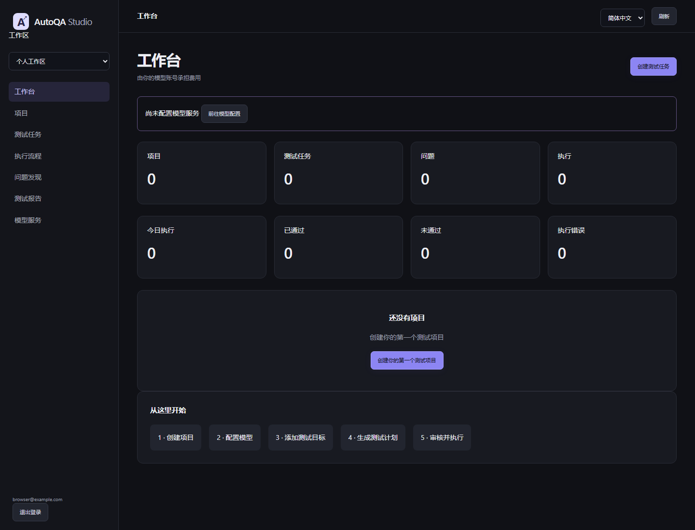

# Phase 5 — Real Product / BYOK / Clean Workspace

验收日期：2026-10-01（Asia/Shanghai）。开发基于现有 AutoQA Studio，保留旧测试与 Demo；本轮没有部署现有 Railway 服务，也没有读取、清空或迁移公网 Demo 数据库。

## 验收矩阵

| # | 项目 | 实现与验收边界 |
| --- | --- | --- |
| 1 | Production 无 Seed | 全新 SQLite、明确 `AUTOQA_MODE=production`，首次注册后 Projects / Tasks / Findings / Executions 均为 0。没有 Login Demo、历史演示结果或种子 Finding；HTTP 与真实 Chromium 均已验收。系统仅建表及部署模式标记，业务数据不自动插入。 |
| 2 | 开发者 Key fallback | Production 全局 `provider_key` 为空；通用全局 provider factory 拒绝生产调用；模型只能由工作区 Gateway 创建。未配置返回 409，模型 401 / 网络失败记执行错误，不回退 Mock 或开发者 Key；已测试。 |
| 3 | Key 加密 | AES-256-GCM、随机 12 字节 nonce、32 字节主密钥、工作区绑定的 associated data。数据库只保存 `encrypted_api_key` 和掩码；跨工作区解密失败测试通过。 |
| 4 | 浏览器 Key 返回 | 保存 / 查询 / 失败响应均无完整 Key，只显示 `sk-••••••••1234`；连接测试与日志 canary 检查通过。解密请求后清除对象引用，不声称实现 Python 内存物理擦除。 |
| 5 | Workspace 隔离 | users / workspaces / members、Owner / Member、工作区模型配置、项目 ownership 均持久化；注册自动创建个人工作区，查询以当前用户成员关系和工作区过滤。 |
| 6 | A 访问 B 数据 | 项目、任务、Workflow、Findings、Report HTML / JSON、SSE、Artifact、环境与接口规范，以及修改 / 审批 / 取消 / 重新生成均做归属检查；跨用户 / 工作区与修改 ID 测试返回 404。没有复杂企业 RBAC。 |
| 7 | OpenAPI | 已支持通用接口，OpenAPI 3.x / Swagger 2、URL / JSON / YAML / 手动配置、path / method / parameters / JSON body / response schema / 本地 refs，选择接口后 AI 规划。不是“任意规范完全兼容”：远程 / 循环 refs、multipart、OAuth 自动授权、复杂方言未支持。 |
| 8 | 用户 Web URL | 使用已有 LangGraph + Playwright 观察用户目标、生成计划、修改与审批、实际浏览器执行和证据。真实 Chromium 已在独立 HTTP 测试站点验收，使用仅本次运行的账号；真实外部业务项目未实际验收。 |
| 9 | 中文 | Production 操作 UI 默认简体中文，集中 zh-CN / en-US 字典，导航、状态、阶段、模型、环境、计划、Empty State、Onboarding 支持切换；Chromium 验收通过。后端错误和导出报告暂无完整英文化。旧 Demo 混合界面保持兼容。 |
| 10 | Demo / Production | 显式两种模式；生产不挂载 Demo 页面与开发前端，部署模式标记阻止共用数据库，生产拒绝接管旧 Demo 库。旧安装未设置 mode 时保持兼容；新 Production 必须显式指定。建议分开 Railway 环境 / 服务 / DB / Volume。 |
| 11 | Migration | `0001_legacy` + `0002_product`，启动执行 Alembic；空库、重复升级、旧项目及关联任务保留、FK integrity 已在 SQLite 验收。没有 destructive downgrade。真实 Production MySQL 的独立数据库验收配置在 CI；本地无 MySQL 服务。 |
| 12 | 测试 | 原有 53 项保留，新增 48 项，总计 101 项。本地最终 JUnit 结果见 `docs/phase5-test-results.xml`；MySQL 两项本地跳过。Provider 全为 fixture Key / Mock HTTP，Web 使用真实 Chromium。 |
| 13 | CI | workflow 保留旧 Demo / Studio / MySQL 检查，新增 Production UI/API 测试、JS 语法、迁移 lint 和独立 Production MySQL 数据库。远程 run 编号与结果以最终交付信息 / GitHub Actions 为准；本地测试不能替代远程 CI。 |
| 14 | Commit | 所有变更放在 `codex/phase5-real-product`；最终交付消息提供实际新增 SHA。主分支和公网部署不在本次发布范围。 |
| 15 | Railway 环境变量 | 必需 mode / env / 主密钥 / 独立 DATABASE_URL / artifact 与 data 路径 / HOST / 平台 PORT。可选公共域名、并发、可信代理与 self-hosted 内网 opt-in；不得配置开发者模型 Key。完整操作步骤见 [Production 部署指南](production-deployment.md)。 |
| 16 | 生产缺项 | 见下方限制；当前是可验证的产品架构基础，不是经过大规模真实用户运营验证的成熟 SaaS。 |

## 实际通过的业务链

- 注册 → 个人工作区 → 干净工作台 → 中文 / English 切换；真实 Chromium 继续验收模型连接与保存、项目创建、文件导入、增改 Case、审批执行和报告下载。
- Provider 测试连接 / 加密保存 / 更换或删除 / 会话保存隔离 / 退出与过期 / 工作区持久配置重启恢复。
- API 项目 → 导入普通用户与订单接口规范 → 选择接口 → fixture 模型规划 → 人工增加 / 删除 / 修改 Case → 审批 → 实际 HTTP transport 执行 → Schema / 状态断言 → Finding / Report / 历史。
- Web 项目 → 输入独立站点 URL 与临时账号 → 页面观察 → fixture 模型规划 → 修改计划 → 审批 → Chromium 登录与订单断言 → 通过结果、脱敏 DOM / 证据、临时账号不落库。
- 系统网络失败 → `system_error` → 业务失败计数 0、无伪造 Finding。
- 用户 B 修改 A 的资源 ID 或工作区头 → 404，无数据泄漏。计划修改和审批在当前进程内串行化，界面审批提交计划 hash，旧版本审批返回 409。

## 仍不适合直接无门槛公网开放的部分

1. 认证缺少邮件验证、找回 / 修改密码、MFA 和账号生命周期；有密码哈希、会话过期、CSRF 和基本登录限流，尚未完成外部安全审计。
2. 运行队列与临时配置为进程内状态，需要单进程、单副本。缺少分布式 Worker、全局资源额度和多副本会话配置同步；限流也不是分布式实现。
3. 缺少主密钥轮换 / 旧密文重加密工具、业务数据导出 / 删除 / 保留策略，以及对象存储的证据生命周期。
4. Web 当前按步骤和显式断言执行，遇失败可提前停止，尚未实现独立多 Case Suite、复杂跨域登录、自动账号登录发现。使用账号占位符配合明确选择器完成规划；不保证任意网站可自动生成正确计划。
5. API 当前以 JSON 请求和状态码 / JSON Schema 断言为主，不支持完整 OpenAPI 方言、multipart、复杂参数序列化、OAuth 自动令牌流程或无限制递归 / 远程 refs。公共端口限制为 80 / 443 / 8080 / 8443，特殊内网场景需 self-hosted opt-in。
6. 计划 UI 提供可增删 Case 的 JSON 编辑器，尚未实现成熟的可视化 Case 编排。重新生成创建新任务保留旧审核历史。
7. Finding 的故障归类与提示仍包含规则逻辑；“AI 分析建议”不代表经服务端日志证实的根因，固定保持 `root_cause_confirmed=false`。
8. 对配置的已知秘密进行值匹配和敏感字段脱敏；不能保证任意目标页面的所有未知个人数据都被自动识别。Production 关闭 Trace，配置运行变量时关闭截图，需要后续更精细的证据隐私控制。
9. 历史列表当前最多显示当前工作区最近 200 个任务；没有服务端分页和长期趋势。Dashboard 统计全历史真实数据。
10. 跨用户 API / Workspace 隔离与 SSRF 路径已测试，但容器隔离、浏览器沙箱、资源耗尽和全面渗透测试未实际验收。

## 未实际验收

- 新 Railway Production 环境、真实收费 DeepSeek / OpenAI / Compatible 模型、真实外部业务项目：未实际验收，且未使用真实模型 Key / 费用。
- Docker 容器启动与 Docker Compose runtime：未实际验收，本机没有 Docker CLI / engine；配置结构检查已通过。
- 本地真实 MySQL：未实际验收；两个 MySQL acceptance 在本地跳过，远程 CI 结果另列。
- 用户增长、长时间稳定性、大规模并发和正式备份恢复演练：未实际验收。

对应自动化：`tests/test_product.py`、`tests/test_product_browser.py`、`tests/test_product_mysql.py`。完整部署说明见 [独立 Production 部署指南](production-deployment.md)。
