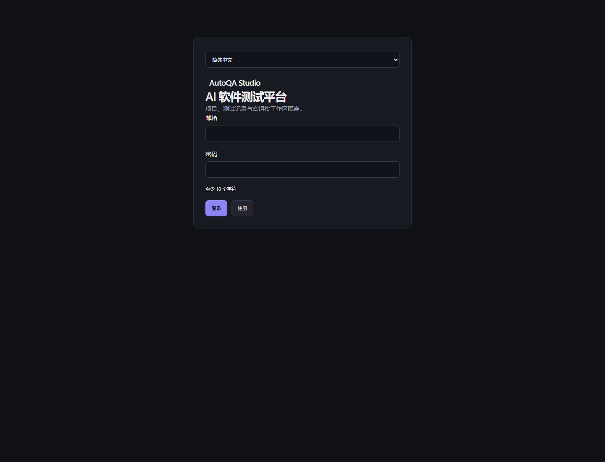
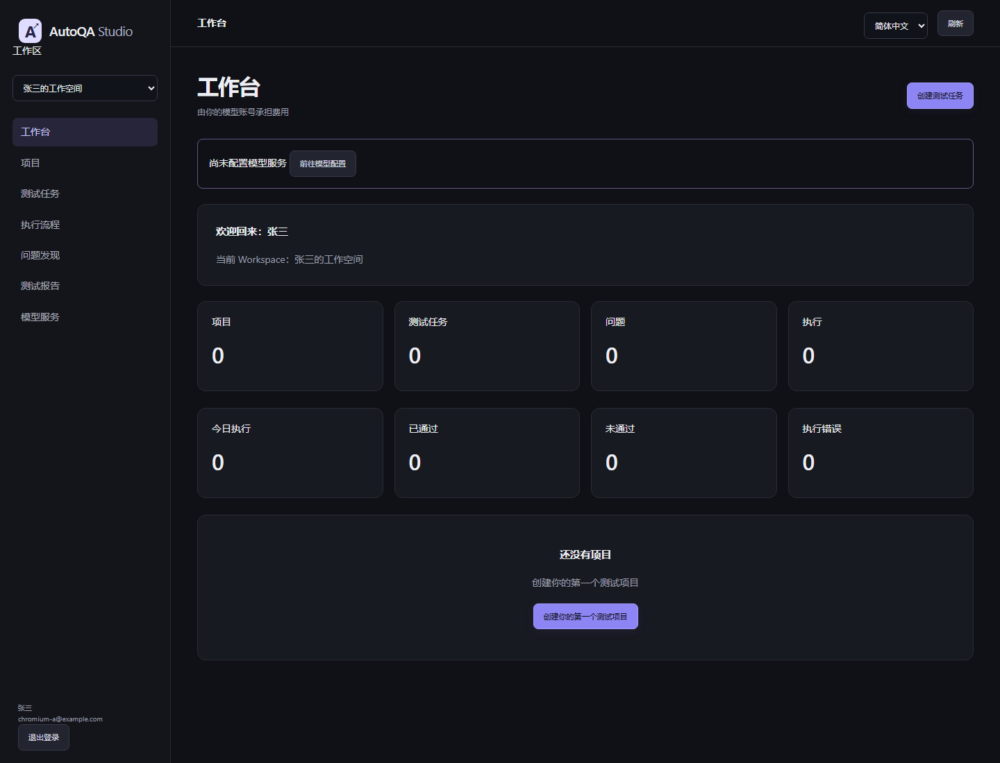

# Phase 6-1 — 用户认证与 Workspace 产品化

验收日期：2026-10-01（Asia/Shanghai）。继续 `codex/phase5-real-product`，实际工作目录为 `C:\Users\13432\.codex\worktrees\d187\AutoQA-Agent`。D 盘主 checkout 仍为 main，未修改其工作内容。本轮仅实现用户系统与工作区基础，保留既有 Agent、Provider Gateway、Demo / Production 分离和 Railway 配置。

## 1. 修改文件列表

| 文件 | 修改 |
| --- | --- |
| `autoqa/auth.py` | JWT 签发 / 验证、CurrentUser、用户响应字段白名单 |
| `autoqa/crypto.py` | scrypt 参数升级，兼容旧密码哈希 |
| `autoqa/product_models.py` | 用户状态 / 昵称 / 更新时间、工作区 Owner、成员 ID / 时间、refresh 哈希 |
| `autoqa/product_schemas.py` | 注册昵称、刷新输入、邮箱格式及大小写归一化 |
| `autoqa/product_app.py` | 注册 / 登录 / 刷新 / 退出、统一认证、CSRF、SSE 校验与 Artifact 隔离 |
| `migrations/versions/0003_auth.py` | Phase 5 数据的加法迁移、旧成员 / Owner 回填 |
| `autoqa/static/production.js` | 登录 / 注册、欢迎信息、自动刷新、退出清理与旧请求结果丢弃 |
| `autoqa/static/production.css` | 移动端保留退出入口，语言控件布局 |
| `autoqa/static/locales/zh-CN.json` | 简体中文认证与欢迎文案 |
| `autoqa/static/locales/en-US.json` | 对应英文文案 |
| `pyproject.toml` | 显式声明 PyJWT，Wheel 包含新迁移；requirements.lock 已有 PyJWT 2.15.1，无须更改 |
| `.github/workflows/ci.yml` | 上传认证 UI 证据；新增独立 MySQL 升级验收 |
| `tests/test_auth.py` | 认证、安全、隔离、迁移与 NTFS junction 用例 |
| `tests/test_auth_browser.py` | Chromium 双用户完整流程及自动刷新 |
| `tests/test_product.py` | 仅将既有迁移版本断言更新为 0003_auth，保留全部旧用例 |
| `README.md` | Authentication Architecture、API / JWT / 隔离说明 |
| `docs/production-deployment.md` | 升级要求、JWT 和主密钥用途说明 |
| `docs/phase6-1.md` | 本验收报告 |
| `docs/phase6-test-results.xml` | 最终完整 JUnit 结果 |
| `docs/phase6-ui-results.json` | 生产 UI 七步验收与移动端退出结果 |
| `docs/phase6-demo-results.json` | 公开 Demo 八项浏览器检查 |
| `docs/phase6-studio-results.json` | 旧 Studio 十二项浏览器检查 |
| `docs/assets/phase6-login.png` | 未登录页面 |
| `docs/assets/phase6-empty.png` | 用户 A 的空工作区 |
| `docs/assets/phase6-second-user.png` | 用户 B 的独立空工作区 |
| `docs/assets/phase6-mobile.png` | 移动端工作区和退出入口 |

## 2. 数据库模型与迁移

复用并完善已有表，未重复创建用户体系：

- UserRow / users：id、唯一 email、password_hash、nickname、is_active、created_at、updated_at；is_active=true 为 active，false 为 disabled。
- WorkspaceRow / workspaces：id、name、owner_id、created_at、updated_at。注册新工作区必须有 Owner；历史无成员工作区允许 owner_id=NULL，避免破坏旧记录。
- MemberRow / workspace_members：id、workspace_id、user_id、role、created_at。保留既有复合主键和用户 / 工作区唯一关系，新增唯一成员 ID；仅 Owner / Member 两种角色。
- SessionRow / user_sessions：原有会话标识哈希、user_id、expires_at，新增 refresh_token_hash、created_at。JWT 原文不落库。
- ProjectRow 保持 workspace_id，所有新项目从已验证的当前 Workspace 取得归属。

Alembic `0003_auth` 回填用户昵称 / 更新时间、成员 ID / 时间、既有 Owner，保留密码、项目、工作区名称及旧会话行。SQLite 已验证升级、重复升级、旧数据保留、外键完整性、旧密码重新登录后升级。真实 MySQL 验收使用 CI 新建的独立 autoqa_auth_ci 数据库，不接触线上数据。运行与迁移均不调用 create_all。旧 Demo 项目仍可保持 workspace_id=NULL，不自动分配给注册用户。

## 3. API 列表

| 接口 | 请求与行为 |
| --- | --- |
| POST /api/auth/register | email、password、nickname；原子创建用户 / 个人工作区 / Owner / 会话，返回 user 与令牌对，自动登录 |
| POST /api/auth/login | email、password；正确密码且 active 才可登录，返回 access_token、refresh_token、user |
| POST /api/auth/refresh | JSON refresh_token 或浏览器 Cookie；验证 refresh 哈希，轮换新的令牌对 |
| POST /api/auth/logout | Bearer access、JSON refresh 或 refresh Cookie；撤销当前会话，清除 cookie 与临时模型配置，204 |
| GET /api/auth/me | 有效 access；返回本人基本信息、成员工作区、当前 Workspace 和 CSRF |
| GET /api/auth/csrf | 有效 refresh Cookie；只返回 CSRF，供页面重新打开后恢复登录 |
| POST /api/workspace/members | Owner 添加已注册且 active 的 Member；不新增 Owner / 所有权转移 |

保留 Phase 5 无昵称的注册客户端，昵称默认为邮箱前缀，其默认工作区名仍为“个人工作区”；填写昵称时为“昵称的工作空间”。注册密码长度 10–128；登录时不以注册长度规则替代密码验证，错误短密码同样返回 401。邮箱统一 strip / lower，数据库唯一约束防止并发重复。所有用户响应显式白名单，不包含 password_hash。校验与数据库失败响应不包含请求输入、SQL 或异常原文。

## 4. JWT 与密码设计

PyJWT 固定 HS256；签名密钥从既有 32 字节 AUTOQA_SECRET_KEY 以独立用途 HMAC-SHA256 派生。验证签名、iss、aud、exp、iat、nbf、sub、sid、jti、type，并区分 access / refresh。JWT 不接受 alg=none 或错误签名 / issuer / audience / token type。[PyJWT API](https://pyjwt.readthedocs.io/en/stable/api.html)

access 为 15 分钟；refresh 为绝对 7 天，刷新不会延长当前会话截止时间。每次刷新生成新 jti，数据库 compare-and-swap 更新 SHA-256 refresh 哈希；重复 / 并发使用旧令牌只允许一个请求成功。sid 是会话标识哈希，不具备独立登录能力。每次业务访问再查会话、active 用户与成员关系，所以退出后原 access 和 refresh 都不可继续使用。

浏览器 Cookie：HttpOnly、SameSite=Strict，Production / HTTPS 下 Secure；refresh 限 `/api/auth`。写请求校验 Origin / Sec-Fetch-Site 和 Cookie CSRF。API Bearer 客户端不依赖 Cookie CSRF。浏览器不把令牌保存到 localStorage，页面内和重新打开页面后均能自动刷新；退出清理数据及未完成请求的结果。原 Phase 5 Cookie 不再作为认证凭证，升级后需重新登录。

密码继续采用成熟 scrypt：随机 16 字节盐、N=16384、r=8、p=5，恒定时间比较。兼容原 p=1 哈希，成功登录后升级，不要求重置密码。新配置对应 [OWASP 的 16 MiB scrypt 参数方案](https://cheatsheetseries.owasp.org/cheatsheets/Password_Storage_Cheat_Sheet.html)。没有自定义可逆密码加密。

## 5. Workspace 与 Artifact 隔离

User → Workspace Member → Workspace → Project → Task → Workflow / Finding / Report / Artifact。

Production 业务 `/api` 入口统一建立 CurrentUser。客户端 X-Workspace-ID 必须匹配当前用户的成员关系；项目查询带 workspace_id 条件。任务通过 TaskMetadata → Project 继承工作区；明细、审批、取消、计划、重新生成、SSE、报告与证据都先检查任务归属。A 修改 ID 或工作区 Header 请求 B 资源返回 404，响应不披露名称、描述、任务或证据。

Artifact 无匿名静态挂载；仅允许生成文件的简单文件名和 png / json / html 后缀。拒绝 slash、反斜杠、空字节、路径遍历、符号链接、Windows NTFS junction。解析后的目录必须等于当前任务的实际目录，文件必须位于其中。已在 Windows 创建真实 junction 指向另一个用户的任务目录，下载请求返回 404；普通文件符号链接用例本地因权限跳过，Linux CI 执行。

SSE 连接内持续复核用户 active、会话有效期、access 过期时间、成员与任务归属。前端账号 / 工作区切换清空旧数据、丢弃旧请求结果，避免显示上一用户的数据。

## 6. 新增测试数量

保留原有 101 项。新增 49 项有效测试，总计 150 项：test_auth.py 47 项（含不同 JWT 攻击输入、受保护业务入口和双数据库迁移），test_auth_browser.py 2 项完整 Chromium 流程。未使用真实模型 API。

## 7. 全部测试与构建结果

最终全套：**146 passed、4 skipped、0 failed / error**，共 150 项，耗时 235.03 秒。完整记录见 [JUnit](phase6-test-results.xml)。1 个警告来自 Python 3.12 默认 SQLite datetime adapter 的弃用提示，不影响已验证的迁移。

本地四个跳过项：旧数据库 MySQL 兼容性、Production MySQL 全流程、Phase 5 → Phase 6 MySQL 迁移，以及 Windows 无权限创建的普通文件符号链接。前三项在独立 MySQL CI 数据库执行；第四项由 Linux 主 Job 执行，另有实际 Windows NTFS junction 测试已通过。跳过不等于已在对应环境通过。

额外检查：Ruff、全部五个 JavaScript 文件语法、部署配置结构均通过；独立 Wheel 已成功构建，并验证包含 auth.py、0003_auth.py 和 PyJWT 依赖。UI 布局与时钟边界断言调整后，相应 Chromium / 认证用例再次通过；短错误密码 401 与注册校验也单独复核。旧 Studio 浏览器 12 项和公开 Demo 浏览器 8 项通过，均无 JavaScript 错误。

GitHub Actions 已保留全部旧步骤，增加 MySQL Phase 5 → Phase 6 验收和认证 UI 证据上传。此次未 push，未运行新的远程 CI；不能将本地通过等同于新的远程 CI 已通过。

## 8. UI 验收结果

真实 Chromium，独立临时 SQLite / HTTP 目标、fixture 账号，七步均通过：

1. Production 打开显示 AutoQA Studio、AI 软件测试平台、登录 / 注册入口。
2. 注册张三，自动进入工作台，显示昵称及其工作区。
3. 八项统计全 0，显示“还没有项目 / 创建你的第一个测试项目”，没有 Demo 数据。
4. 创建用户 A 的私有项目。
5. 退出，认证 Cookie 清除，返回登录界面。
6. 重新登录，项目和描述仍保留。
7. 同一浏览器创建用户 B，项目 / 任务 / 问题为 0；请求 A 的项目返回 404。

额外验证：access Cookie 消失后页面内自动刷新；重新打开页面通过 CSRF bootstrap 恢复会话；移动端退出入口可用、无横向溢出；无 pageerror。未新增 Onboarding 或模型向导。

## 9. Demo 影响

AUTOQA_MODE=demo 继续走原公开体验入口、允许 Seed、保留原配额与审批；不强制用户注册。旧 Demo / Studio 浏览器验收与全部旧测试保留。线上 Demo、其数据库、环境变量和部署均未修改。

## 10. Production 部署影响

Production 仍无 Seed、不回退开发者模型 Key；Provider Gateway、AES-256-GCM 格式、Agent 核心、Railway / Docker 配置不变。新增依赖已在原 lock 中，主密钥不变，无新增必需环境变量。Wheel 包含新迁移。升级运行 Alembic head；备份数据库，Phase 5 用户需重新登录。实际新 Railway Production、Docker runtime、真实模型和外部真实业务项目未部署 / 未实际验收。

## 11. 新增 Commit

在 codex/phase5-real-product 提交 `feat: add user authentication and workspace isolation`，实际 SHA 由最终交付消息提供。未修改 main、force push 或删除历史；未推送、合并或触发线上部署。

## 12. 剩余限制

- 只完成 Phase 6-1；不含邮件验证 / 密码找回、MFA、管理后台、所有权转移、支付 / 计费或企业 RBAC。维护者通过数据库 is_active 控制禁用状态。
- 注册允许无昵称是 Phase 5 API 兼容行为；历史无成员工作区 owner_id 可空，旧复合成员主键保留。
- 当前会话 refresh 哈希轮换可阻止旧令牌再刷新；没有刷新令牌家族的额外重放告警或整族封禁、跨标签页刷新协调。
- 仍需单进程 / 单副本：登录限流、队列和会话级模型配置在内存；未增加分布式认证限流 / Worker。
- 没有主密钥轮换工具、清理过期会话的后台任务、对象存储 / 文件保留策略或全面外部渗透测试。
- 本地没有 MySQL / Docker，相关真实环境结果不能宣称已通过。Linux 普通符号链接隔离由 CI 执行；Windows junction 已实际验证。
- Phase 5 其余测试引擎 / OpenAPI / 证据隐私限制继续存在，见 [Phase 5 报告](phase5.md)。这是 SaaS 产品基础，未宣称 enterprise ready 或 production complete。
