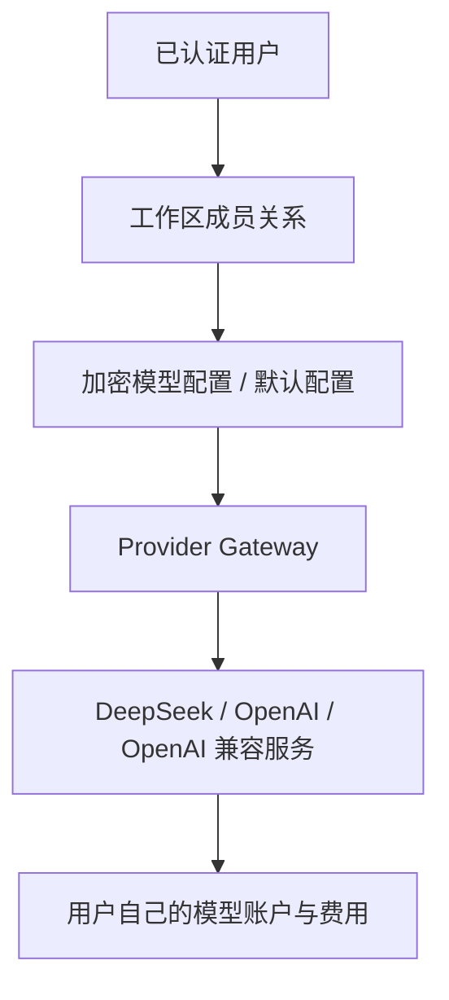
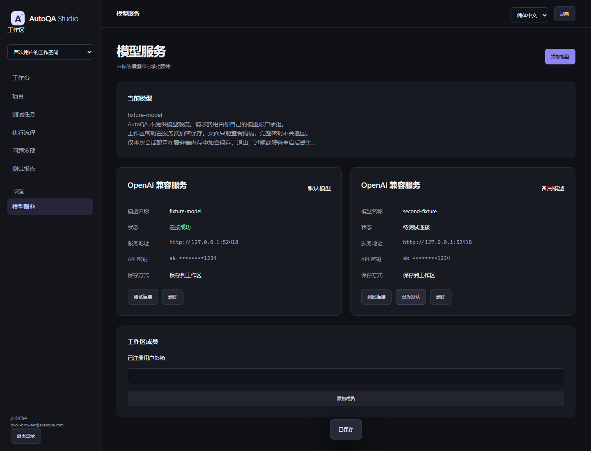
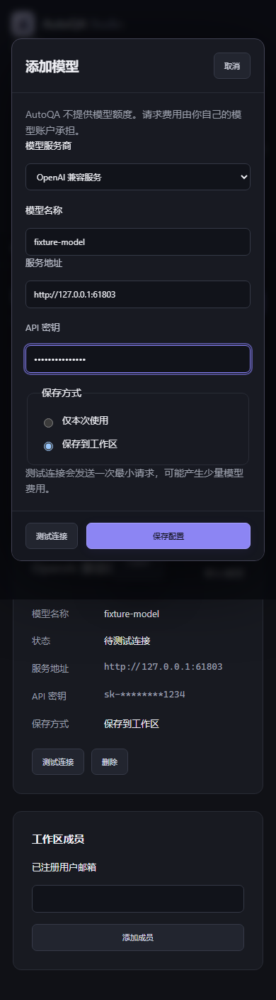

# Phase 6-2-B：BYOK 模型配置中心

日期：2026-10-01（Asia/Shanghai）。分支：`codex/phase5-real-product`。起点：`ca8e7f9`。

本阶段让真实用户安全配置自己的模型服务，所有模型费用计入用户自己的账户。AutoQA 不提供模型额度。实现仅涉及生产模型配置中心、Gateway 配置选择、连接探测和已有引导接入；未开发 Phase 6-2-C。

## 1. 修改文件

| 文件 | 作用 |
| --- | --- |
| `autoqa/product_models.py` | 多配置模型、默认槽位约束、连接状态和时间字段 |
| `migrations/versions/0005_provider_center.py` | 保留旧密文的 SQLite / MySQL 迁移 |
| `autoqa/product_schemas.py` | 输入校验、供应商枚举、密钥不能进入公开元数据 |
| `autoqa/crypto.py` | 明确要求 256 位加密主密钥，保留原 GCM 信封格式 |
| `autoqa/gateway.py` | 工作区多配置 CRUD、默认选择、最小请求、解密引用清理 |
| `autoqa/product_app.py` | 新 API、Owner 权限、地址校验和安全错误响应 |
| `autoqa/onboarding.py` | 从默认模型配置识别工作区模型里程碑 |
| `autoqa/static/production.js`、`production.css` | 中文模型列表、弹窗、状态、默认切换、手机布局 |
| `autoqa/static/locales/zh-CN.json`、`en-US.json` | 中文字段及现有语言切换兼容 |
| `pyproject.toml` | Wheel 包含新增迁移 |
| `.github/workflows/ci.yml` | MySQL CI 纳入 BYOK 迁移及 API 验收，保存新截图 |
| `tests/test_provider_center.py` | 密钥、隔离、权限、异常、并发及 Gateway 安全测试 |
| `tests/test_provider_center_compat.py` | 相同流程在 SQLite / MySQL 下运行，包含旧密文迁移 |
| `tests/test_provider_center_browser.py` | 真实 Chromium 的中文配置、引导、隔离和手机流程 |
| `tests/test_product.py`、`test_onboarding.py`、`test_docker_production.py`、`test_production_compatibility.py` | 更新迁移 head 断言，保留原有验证 |
| `tests/test_product_browser.py`、`test_onboarding_browser.py` | 旧浏览器验收适配弹窗和真实模型入口 |
| `README.md`、本报告、`docs/assets/phase6-2b/*.png`、测试 XML | 架构说明和验收证据 |

## 2. 数据库变化

迁移链：`0004_onboarding → 0005_provider_center`。

`provider_configs` 从 `workspace_id` 主键改为 `id` 主键，工作区外键和索引保留。统一字段：

| 字段 | 说明 |
| --- | --- |
| `id` | 每个配置独立 ID，新配置采用 UUID |
| `workspace_id` | 所属工作区，所有读取和修改均带此过滤条件 |
| `provider` | deepseek / openai / compatible |
| `model_name` | 模型名称，原数据库字段 model 重命名 |
| `base_url` | 服务地址 |
| `encrypted_api_key` | AES-GCM 密文，不存明文密钥 |
| `api_key_hint` | 仅掩码，原 key_mask 重命名 |
| `is_active` | 工作区默认模型标记 |
| `created_at`、`updated_at` | UTC 创建、修改时间 |
| `connection_status` | untested / connected / failed |
| `active_workspace_id` | 内部默认槽位，默认配置为 workspace_id，备用配置为 NULL |

唯一槽位及 CHECK 约束共同防止同一工作区出现多个默认模型或默认标记不一致。增删和切换先锁定工作区写事务，兼容 SQLite 与 MySQL。新增配置自动成为默认；删除默认配置后启用最近添加的备用配置；删除最后一个配置恢复未配置状态。

旧配置 ID 取原 workspace_id，旧密文逐字复制，保留 `provider:<workspace>` 的 associated data。新迁移不会读取明文密钥，不会给旧记录虚构连接成功状态。ORM 保留 model / key_mask 别名以支持原有代码。

## 3. Provider 架构

业务代码继续通过 ProviderGateway 解析工作区配置。现有 Provider 适配器及生成请求格式没有修改，没有引入环境 Key、额外模型或 Mock 回退。临时会话配置优先于该会话的工作区默认模型；工作区其他用户不受此覆盖影响。

## 4. API 列表

| API | 权限及行为 |
| --- | --- |
| `GET /api/settings/providers` | 工作区成员读取列表，包含 provider、model、masked_key、status、id、默认标记及服务地址 |
| `POST /api/settings/providers` | Owner 新增配置；输入 provider、model、api_key、base_url，可选 save_mode，默认 workspace；返回 201 |
| `DELETE /api/settings/providers/{id}` | Owner 删除所属工作区配置；返回 204 |
| `POST /api/settings/providers/{id}/test` | Owner 对已有加密配置做最小连接测试；成功返回 status=success 与配置模型名称 |
| `POST /api/settings/providers/{id}/activate` | Owner 切换工作区默认模型 |

所有 API 需要有效登录，浏览器写请求还校验 CSRF / Origin。跨工作区或不存在的 ID 返回相同 404。Member 只能读取掩码，无权修改或发起模型付费请求。`id=session` 表示当前登录会话的临时加密配置，可测试和删除。

保留原 `/api/provider` GET / PUT / DELETE 与 `/api/provider/test` 响应契约供现有客户端使用。旧测试接口也改用 Gateway 最小探测；业务生成调用继续使用原 Provider 适配器。

## 5. Key 加密方案

用户输入 → FastAPI 校验 → AES-256-GCM → 数据库。主密钥仍为已有 `AUTOQA_SECRET_KEY`，必须解码为 32 字节。每次加密使用独立 12 字节随机 nonce，认证标签包含在 v1 信封中。

新持久配置的 associated data 为 `provider:<workspace>:<config_id>`，同时绑定工作区与配置。临时配置绑定工作区与登录会话，密文仅存在服务器内存，不写数据库。旧记录保留原工作区绑定信封以兼容已保存密钥。

请求时 Gateway 读取密文并局部解密，调用用户服务后关闭客户端、移除连接请求的 Authorization 引用并清空密钥引用。现有生成客户端也在成功或异常后清空 provider / settings 的密钥字段。Python 字符串不提供物理内存擦除保证；此处保证不持久化明文和不长期保留解密引用。

API 不返回完整密钥或密文，页面显示例如 `sk-********1234`。输入校验拒绝把密钥放入模型名称或服务地址，验证错误不会回显请求体。异常正文、真实堆栈、服务商返回的错误体不进入响应或日志。

## 6. 前端流程

“设置 / 模型服务”使用 `/#settings/providers`，旧 `#model` 自动兼容。深色中文页面展示当前模型、默认 / 备用标记、服务地址、连接状态和密钥掩码。

添加模型弹窗提供 DeepSeek、OpenAI、OpenAI 兼容服务，包含模型名称、服务地址、密码类型的 API 密钥输入和保存方式。默认“保存到工作区”；“仅本次使用”也可用，退出、过期或服务重启后失效。页面不使用 localStorage / sessionStorage 保存密钥，取消、Escape、测试完成、保存、退出或切换工作区均清除密钥输入。

保存不自动产生模型费用，状态先为“待测试连接”。点击“测试连接”后，Gateway 创建临时客户端，仅发送一条消息，`max_tokens=1`，整体超时 15 秒，响应上限 64 KiB，拒绝重定向。连接成功后工作台显示“✓ 模型已连接”；仅保存但未探测时显示“模型已配置，待测试连接”；无模型显示“尚未配置模型服务”与“配置模型”按钮。

## 7. Onboarding 集成

第 2 步“配置模型”现在进入真实配置中心。成功保存更新当前用户、当前工作区的 `model_configured=true`；前端继续已有第 3 步项目创建。刷新后恢复进度。用户仍可“稍后设置”或从配置中心返回引导。

本阶段没有新增测试任务、导入接口、运行浏览器或标记 `first_test_completed=true`。连接探测只检查模型服务；相关测试断言项目和任务集合保持为空。

## 8. 新增测试

三个新测试文件共 **75 个测试用例**，含 5 个 Chromium 流程和 SQLite / MySQL 参数化验收。其中要求的六个安全测试均已实现：

- `test_provider_key_encrypted`
- `test_provider_api_not_return_plain_key`
- `test_provider_key_mask`
- `test_workspace_provider_isolation`
- `test_invalid_provider_config`
- `test_connection_failure_safe_response`

其他覆盖：工作区及配置的密文交换拒绝、随机 nonce、256 位主密钥校验、成员权限、登录 / CSRF、未知 ID、并发新建单默认约束、事务回滚、默认切换、删除后提升备用配置、会话配置、服务重启、异常 / 超时 / 超大响应、三种服务商的最小请求、旧接口安全兼容、旧密文迁移、桌面 / 手机布局及页面工作区隔离。

安全/API 测试使用 httpx.MockTransport；兼容测试使用本地 Mock HTTP Server；浏览器使用假的模型密钥。CI 不读取真实 DeepSeek / OpenAI 密钥，不产生真实模型费用。

## 9. 总测试结果

最终全量：**270 passed、25 skipped、0 failed**（312.08 秒）。基线为 197 passed、23 skipped，本阶段新增 73 个通过用例与 2 个 MySQL 跳过用例，共 75 个新用例。

BYOK 专项独立运行：**73 passed、2 skipped、0 failed**（67.53 秒）。此前包含旧产品与引导的专项回归：139 passed、2 skipped。

证据：[全量 JUnit XML](assets/phase6-2b/all-tests.xml)、[BYOK JUnit XML](assets/phase6-2b/byok-tests.xml)。跳过项分别为 20 个 MySQL、4 个 Docker，以及原有的 1 个 Windows 符号链接权限测试。

Ruff、JavaScript 语法与 git diff 空白检查已通过。Wheel 构建通过，已检查包内包含 `0005_provider_center.py` 与生产前端资源。保护路径与基线比较没有变化。SQLite 旧密文迁移、重复升级和实际 HTTP 请求流程通过；MySQL 与 Docker 需由相应 CI 服务执行，本地不能据跳过项宣称已经验证。

## 10. Demo 影响

Demo HTML、示例页面、原前端、MockProvider、Agent 核心、现有 Provider 适配器、Railway 和 Compose 配置没有修改。共享 Alembic 迁移增加模型配置表结构，但该表不参与 Demo 测试行为。旧 Demo / 浏览器 / 配额 / 报告回归继续运行。

没有部署线上 Demo，没有合并 main，没有进入 Phase 6-2-C。

## 11. Git

继续已有 `codex/phase5-real-product` 分支，工作目录为已检出的 `d187/AutoQA-Agent`，基线 `ca8e7f9`。提交说明：`feat: add BYOK model configuration center`。具体提交 hash 见最终验收回复。

`D:\agent 项目\AutoQA-Agent` 当前 main 上的已有文档改动保留，未切换或覆盖。

## 12. 剩余限制

- 本机没有提供可用的 MySQL / Docker 服务，本阶段对应新增 MySQL 用例本地跳过；CI 已纳入这些用例，本次未推送或执行远程 CI。
- 按要求未使用真实模型 Key，因此真实账户、额度和厂商当前模型可用性没有进行收费实测。
- 连接状态反映最近一次探测结果，后续服务或余额变化需重新测试；保存配置不会虚构连接成功。
- 兼容服务须支持 `/chat/completions` 及 `max_tokens`，暂不扩展其他厂商协议。
- 临时配置是进程内状态，多副本之间不共享；工作区持久配置为优先路径。
- 主密钥轮换、KMS、模型余额管理与配额系统不在本阶段；迁移前仍需备份数据库。
- 未实现 Phase 6-2-C 的首次测试执行、OpenAPI 或 Web 测试新流程。
